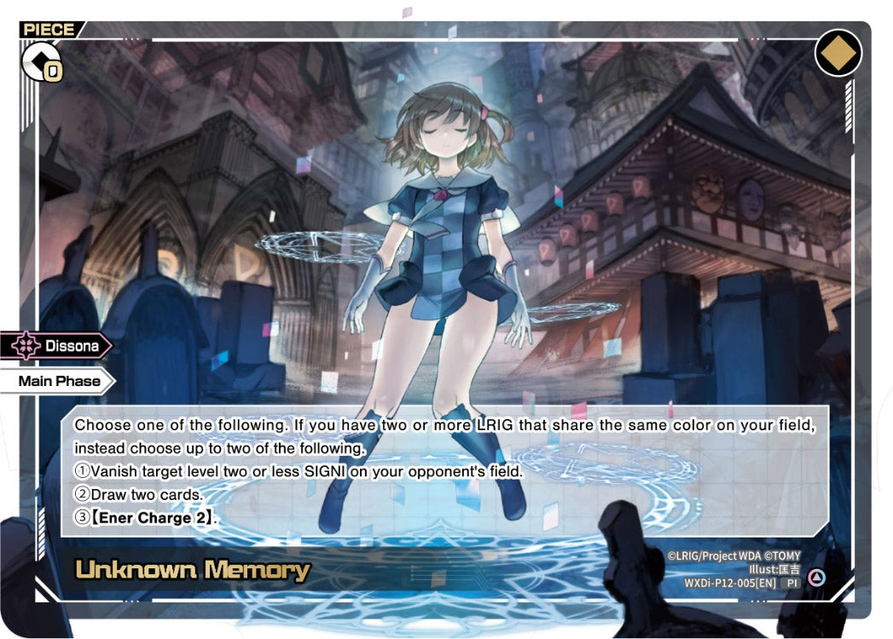

# Unknown Memory

## Thông tin lá

| Trường | Giá trị |
| --- | --- |
| Mã in | WXDi-P12-005[EN] |
| Set | WXDi-P12[EN] |
| Số thứ tự | 005 |
| Loại thẻ | PIECE |
| Vị trí | LRIG Deck |
| Số bản | — (set booster, không áp dụng) |
| Màu | Không màu |
| Độ hiếm | PI,LRP |
| Minh họa | 匡吉 |
| Level | — |
| Limit | — |
| Power | 0 |
| LRIG type / Class | — |
| Team / Master | — |
| Cost | 《C》×０ |
| Grow cost | — |
| Use timing | Main Phase |
| Life Burst | Không |

## Card text chính thức

Choose one of the following. If you have two or more LRIG that share the same color on your field, instead choose up to two of the following.
①Vanish target level two or less SIGNI on your opponent's field.
②Draw two cards.
③【Ener Charge 2】.

## Power text / Life Burst

—

## Ghi chú minh họa
Artist: 匡吉. Ảnh PI được tải từ Card List tiếng Anh.

## FAQ chính thức

**Q. If I choose and use ② and ③, may I draw two cards after I 【Ener Charge 2】 first?**
A. No, you cannot. Effects are performed in the order from the top to the bottom, so if you choose to use ② and ③, they are always processed in the order of ② and ③.

## Ảnh biến thể

- [LRP](../images/WXDi-P12-005P-EN.jpg)

## Nguồn
[Card List/FAQ chính thức](https://www.takaratomy.co.jp/products/en.wixoss/card/card.html?card_no=WXDi-P12-005%5BEN%5D ) · [Ảnh thẻ](https://www.takaratomy.co.jp/products/en.wixoss/card/thumb/WXDi-P12-005%5BEN%5D.jpg)
