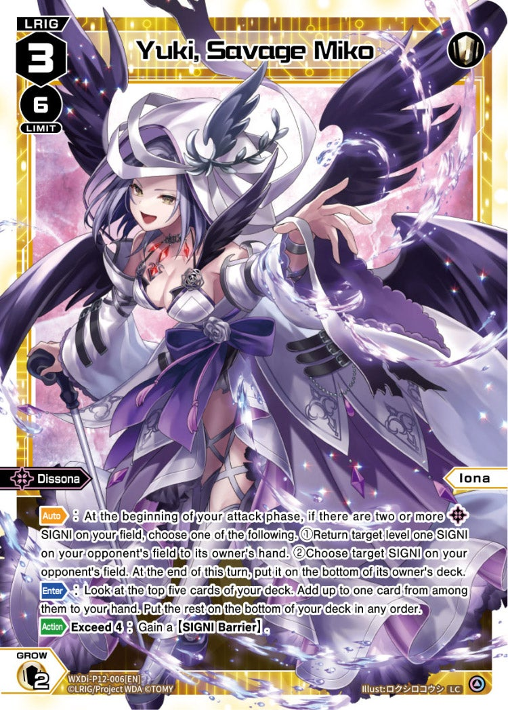

# Yuki, Savage Miko

## Thông tin lá

| Trường | Giá trị |
| --- | --- |
| Mã in | WXDi-P12-006[EN] |
| Set | WXDi-P12[EN] |
| Số thứ tự | 006 |
| Loại thẻ | LRIG |
| Vị trí | LRIG Deck |
| Số bản | — (set booster, không áp dụng) |
| Màu | Trắng |
| Độ hiếm | LC,LR,LRP,UR |
| Minh họa | ロクシロコウシ |
| Level | 3 |
| Limit | 6 |
| Power | 0 |
| LRIG type / Class | Iona |
| Team / Master | — |
| Cost | — |
| Grow cost | 《W》×２ |
| Use timing | — |
| Life Burst | Không |

## Card text chính thức

[Auto]: At the beginning of your attack phase, if there are two or more {Dissona Icon} SIGNI on your field, choose one of the following. ①Return target level one SIGNI on your opponent's field to its owner's hand. ②Choose target SIGNI on your opponent's field. At the end of this turn, put it on the bottom of its owner's deck.
[Enter]: Look at the top five cards of your deck. Add up to one card from among them to your hand. Put the rest on the bottom of your deck in any order.
[Action] Exceed 4: Gain a 【SIGNI Barrier】.

## Power text / Life Burst

—

## Ghi chú minh họa
Artist: ロクシロコウシ. Ảnh LC được tải từ Card List tiếng Anh.

## FAQ chính thức

**Q. After choosing the [Auto] ability ②, before entering end of turn, I have one or less of my SIGNI with {Dissona Icon}. Do I put my opponent's SIGNI chosen in ② at the bottom of its owner's deck at end of turn?**
A. Yes. Whether you have two or more SIGNI with {Dissona Icon} on your field is only checked when the [Auto] ability is triggered, not at the end of the turn.

**Q. Do 【SIGNI Barrier】 or 【LRIG Barrier】 prevent damage from effects as well as attacks?**
A. Yes, for example, 【LRIG Barrier】 can prevent "damaging effects" by LRIG (e.g. 《Hirana, a Step Towards the Top》). Note, however, that it cannot prevent effects that "crush Life Cloth".

**Q. May I choose not to consume 【SIGNI Barrier】 or 【LRIG Barrier】 when taking damage?**
A. No, you cannot. If you take damage, you must be consume it. However, if there are other effects that prevent you from taking damage (such as Enter ability of 《Bang =Da Capo=》), you can choose which one prevents you from doing so.

**Q. Do I lose【SIGNI Barrier】 or 【LRIG Barrier】 when the LRIG loses its abilities?**
A. No, you don't lose them because they are not abilities that the LRIG is gaining.

**Q. May I gain more than one 【SIGNI Barrier】 or 【LRIG Barrier】?**
A. Yes, if there are more than one effects to gain. For example, you may have two 【SIGNI Barrier】; one 【SIGNI Barrier】 is consumed per damage from SIGNI, so in this case you can prevent damage from SIGNI twice.

**Q. May Exceed 4 be paid for with a card underneath the Assist LRIG?**
A. Yes, you can pay by placing a total of four cards from the underneath your LRIG, including Center and Assist, in the LRIG trash.

**Q. May my opponent's SIGNI with 【S Lancer】 be prevented by 【SIGNI Barrier】?**
A. If you have no Life Cloth, the effect of 【S Lancer】 causing damage can be prevented by 【SIGNI Barrier】. If you have Life Cloth, 【S Lancer】 cannot be prevented because its effect is to crush your Life Cloth as well as 【Lancer】.

## Ảnh biến thể

- [LRP](../images/WXDi-P12-006P-EN.jpg)
- [LR](../images/WXDi-P12-006R-EN.jpg)
- [UR](../images/WXDi-P12-006U-EN.jpg)

## Nguồn
[Card List/FAQ chính thức](https://www.takaratomy.co.jp/products/en.wixoss/card/card.html?card_no=WXDi-P12-006%5BEN%5D ) · [Ảnh thẻ](https://www.takaratomy.co.jp/products/en.wixoss/card/thumb/WXDi-P12-006%5BEN%5D.jpg)
