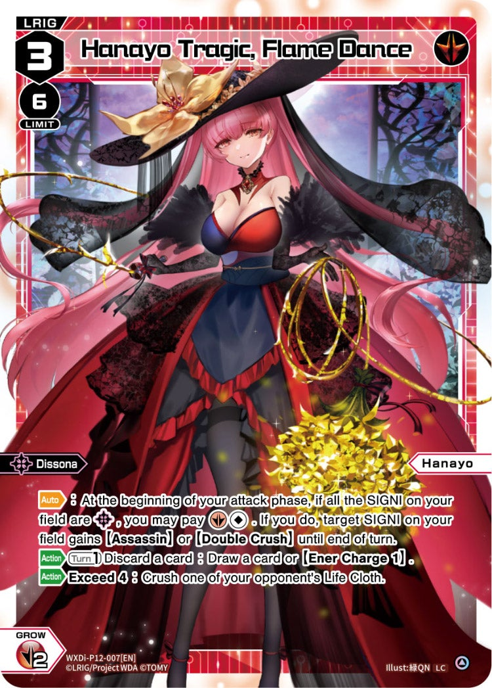

# Hanayo Tragic, Flame Dance

## Thông tin lá

| Trường | Giá trị |
| --- | --- |
| Mã in | WXDi-P12-007[EN] |
| Set | WXDi-P12[EN] |
| Số thứ tự | 007 |
| Loại thẻ | LRIG |
| Vị trí | LRIG Deck |
| Số bản | — (set booster, không áp dụng) |
| Màu | Đỏ |
| Độ hiếm | LC,LR,LRP,UR |
| Minh họa | 緑QN |
| Level | 3 |
| Limit | 6 |
| Power | 0 |
| LRIG type / Class | Hanayo |
| Team / Master | — |
| Cost | — |
| Grow cost | 《R》×２ |
| Use timing | — |
| Life Burst | Không |

## Card text chính thức

[Auto]: At the beginning of your attack phase, if all the SIGNI on your field are {Dissona Icon}, you may pay {Red} {Colorless}. If you do, target SIGNI on your field gains 【Assassin】 or 【Double Crush】 until end of turn.
[Action] {1/Turn} Discard a card: Draw a card or 【Ener Charge 1】.
[Action] Exceed 4: Crush one of your opponent's Life Cloth.

## Power text / Life Burst

—

## Ghi chú minh họa
Artist: 緑QN. Ảnh LC được tải từ Card List tiếng Anh.

## FAQ chính thức

**Q. Is the effect of Exceed 4 prevented if my opponent has 【LRIG Barrier】?**
A. No. 【LRIG Barrier】 is an effect that prevents you from taking damage once when you take damage, but the effect of 《Hanayo Tragic, Flame Dance》 is a "Crush one of Life Cloth" effect, so you can crush it as normal. The same applies to other effects that prevent you from taking damage.

**Q. May Exceed 4 be paid for with a card underneath the Assist LRIG?**
A. Yes, you can pay by placing a total of four cards from the underneath your LRIG, including Center and Assist, in the LRIG trash.

## Ảnh biến thể

- [LRP](../images/WXDi-P12-007P-EN.jpg)
- [LR](../images/WXDi-P12-007R-EN.jpg)
- [UR](../images/WXDi-P12-007U-EN.jpg)

## Nguồn
[Card List/FAQ chính thức](https://www.takaratomy.co.jp/products/en.wixoss/card/card.html?card_no=WXDi-P12-007%5BEN%5D ) · [Ảnh thẻ](https://www.takaratomy.co.jp/products/en.wixoss/card/thumb/WXDi-P12-007%5BEN%5D.jpg)
