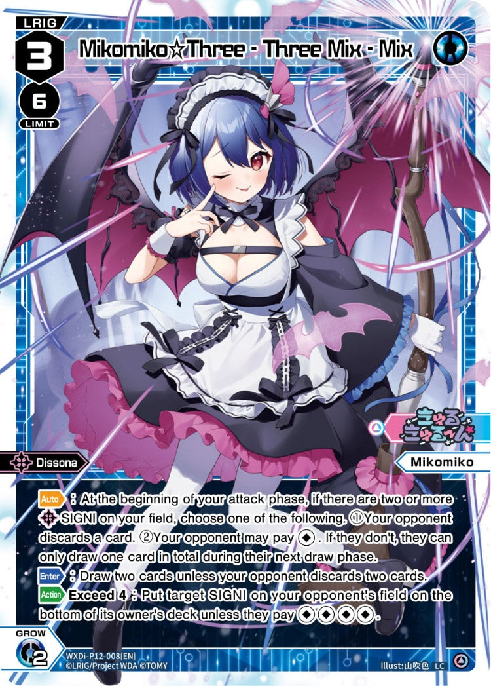

# Mikomiko☆Three - Three Mix - Mix

## Thông tin lá

| Trường | Giá trị |
| --- | --- |
| Mã in | WXDi-P12-008[EN] |
| Set | WXDi-P12[EN] |
| Số thứ tự | 008 |
| Loại thẻ | LRIG |
| Vị trí | LRIG Deck |
| Số bản | — (set booster, không áp dụng) |
| Màu | Xanh dương |
| Độ hiếm | LC,LR,LRP,UR |
| Minh họa | 山吹色 |
| Level | 3 |
| Limit | 6 |
| Power | 0 |
| LRIG type / Class | Mikomiko |
| Team / Master | Kyurukyurun☆ |
| Cost | — |
| Grow cost | 《U》×２ |
| Use timing | — |
| Life Burst | Không |

## Card text chính thức

[Auto]: At the beginning of your attack phase, if there are two or more {Dissona Icon} SIGNI on your field, choose one of the following. ①Your opponent discards a card. ②Your opponent may pay {Colorless}. If they don't, they can only draw one card in total during their next draw phase.
[Enter]: Draw two cards unless your opponent discards two cards.
[Action] Exceed 4: Put target SIGNI on your opponent's field on the bottom of its owner's deck unless they pay {Colorless} {Colorless} {Colorless} {Colorless}.

## Power text / Life Burst

—

## Ghi chú minh họa
Artist: 山吹色. Ảnh LC được tải từ Card List tiếng Anh.

## FAQ chính thức

**Q. In ② of the [Auto] ability, when does my opponent pay {colorless}?**
A. It is when that [Auto] ability is being performed. Your opponent does not pay in your opponent's next draw phase.

**Q. May Exceed 4 be paid for with a card underneath the Assist LRIG?**
A. Yes, you can pay by placing a total of four cards from the underneath your LRIG, including Center and Assist, in the LRIG trash.

**Q. What happens if my opponent has one card in their hand when this [Enter] ability is triggered?**
A. Your opponent cannot discard their hand and you draw two cards because your opponent has not discarded two cards.

## Ảnh biến thể

- [LRP](../images/WXDi-P12-008P-EN.jpg)
- [LR](../images/WXDi-P12-008R-EN.jpg)
- [UR](../images/WXDi-P12-008U-EN.jpg)

## Nguồn
[Card List/FAQ chính thức](https://www.takaratomy.co.jp/products/en.wixoss/card/card.html?card_no=WXDi-P12-008%5BEN%5D ) · [Ảnh thẻ](https://www.takaratomy.co.jp/products/en.wixoss/card/thumb/WXDi-P12-008%5BEN%5D.jpg)
