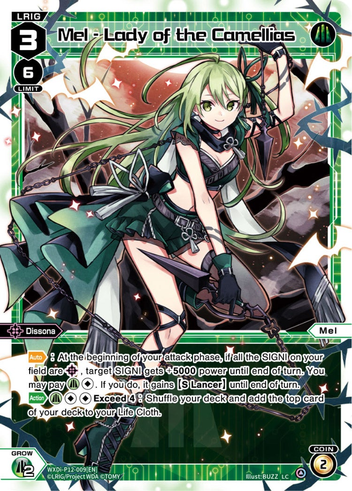

# Mel - Lady of the Camellias

## Thông tin lá

| Trường | Giá trị |
| --- | --- |
| Mã in | WXDi-P12-009[EN] |
| Set | WXDi-P12[EN] |
| Số thứ tự | 009 |
| Loại thẻ | LRIG |
| Vị trí | LRIG Deck |
| Số bản | — (set booster, không áp dụng) |
| Màu | Xanh lá |
| Độ hiếm | LC,LR,LRP,UR |
| Minh họa | BUZZ |
| Level | 3 |
| Limit | 6 |
| Power | 0 |
| LRIG type / Class | Mel |
| Team / Master | — |
| Cost | — |
| Grow cost | 《G》×２ |
| Use timing | — |
| Life Burst | Không |

## Card text chính thức

[Auto]: At the beginning of your attack phase, if all the SIGNI on your field are {Dissona Icon}, target SIGNI on your field gets +5000 power until end of turn. You may pay {Green} {Colorless}. If you do, it gains 【S Lancer】 until end of turn.
[Action] {Green} {Colorless} {Colorless} Exceed 4: Shuffle your deck and add the top card of your deck to your Life Cloth.

## Power text / Life Burst

—

## Ghi chú minh họa
Artist: BUZZ. Ảnh LC được tải từ Card List tiếng Anh.

## FAQ chính thức

**Q. What happens to the effect if there is one of SIGNI without {Dissona Icon} on my field when the [Auto] ability is triggered?**
A. In that case, no further effects are performed, and your SIGNI does not get +5000 power or gain 【S Lancer】.

**Q. May Exceed 4 be paid for with a card underneath the Assist LRIG?**
A. Yes, you can pay by placing a total of four cards from the underneath your LRIG, including Center and Assist, in the LRIG trash.

**Q. When the [Auto] ability is triggered, there is only one SIGNI with {Dissona Icon} on my field, is the condition met?**
A. Yes, in that case the condition is met, even if there is only one, as long as it is SIGNI with {Dissona Icon}. It is not necessary to have a SIGNI with {Dissona Icon} in all SIGNI zones.

## Ảnh biến thể

- [LRP](../images/WXDi-P12-009P-EN.jpg)
- [LR](../images/WXDi-P12-009R-EN.jpg)
- [UR](../images/WXDi-P12-009U-EN.jpg)

## Nguồn
[Card List/FAQ chính thức](https://www.takaratomy.co.jp/products/en.wixoss/card/card.html?card_no=WXDi-P12-009%5BEN%5D ) · [Ảnh thẻ](https://www.takaratomy.co.jp/products/en.wixoss/card/thumb/WXDi-P12-009%5BEN%5D.jpg)
