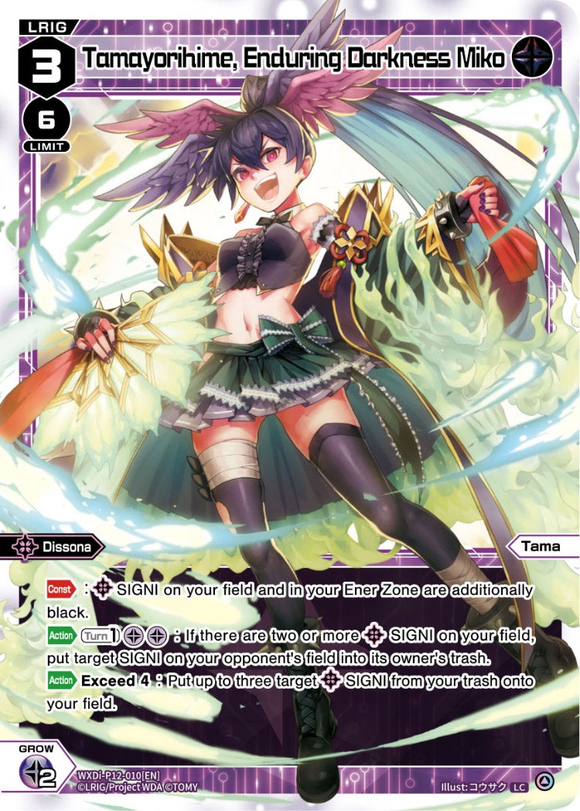

# Tamayorihime, Enduring Darkness Miko

## Thông tin lá

| Trường | Giá trị |
| --- | --- |
| Mã in | WXDi-P12-010[EN] |
| Set | WXDi-P12[EN] |
| Số thứ tự | 010 |
| Loại thẻ | LRIG |
| Vị trí | LRIG Deck |
| Số bản | — (set booster, không áp dụng) |
| Màu | Đen |
| Độ hiếm | LC,LR,LRP,UR |
| Minh họa | コウサク |
| Level | 3 |
| Limit | 6 |
| Power | 0 |
| LRIG type / Class | Tama |
| Team / Master | — |
| Cost | — |
| Grow cost | 《B》×２ |
| Use timing | — |
| Life Burst | Không |

## Card text chính thức

[Constant]: {Dissona Icon} SIGNI on your field and in your Ener Zone are additionally black.
[Action] {1/Turn} {Black} {Black}: If there are two or more {Dissona Icon} SIGNI on your field, put target SIGNI on your opponent's field into its owner's trash.
[Action] Exceed 4: Put up to three target {Dissona Icon} SIGNI from your trash onto your field.

## Power text / Life Burst

—

## Ghi chú minh họa
Artist: コウサク. Ảnh LC được tải từ Card List tiếng Anh.

## FAQ chính thức

**Q. If SIGNI in my Ener Zone gains additional black, may it pay for {black}?**
A. Yes, it is possible. If SIGNI gains an additional color, you can also pay the Ener of the original color, as you have not lost the original color.

**Q. May Exceed 4 be paid for with a card underneath the Assist LRIG?**
A. Yes, you can pay by placing a total of four cards from the underneath your LRIG, including Center and Assist, in the LRIG trash.

## Ảnh biến thể

- [LRP](../images/WXDi-P12-010P-EN.jpg)
- [LR](../images/WXDi-P12-010R-EN.jpg)
- [UR](../images/WXDi-P12-010U-EN.jpg)

## Nguồn
[Card List/FAQ chính thức](https://www.takaratomy.co.jp/products/en.wixoss/card/card.html?card_no=WXDi-P12-010%5BEN%5D ) · [Ảnh thẻ](https://www.takaratomy.co.jp/products/en.wixoss/card/thumb/WXDi-P12-010%5BEN%5D.jpg)
