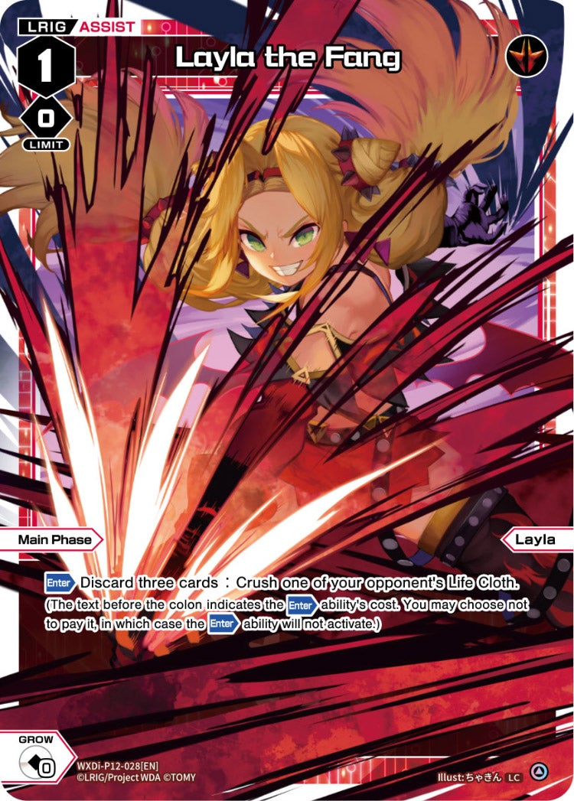

# Layla the Fang

## Thông tin lá

| Trường | Giá trị |
| --- | --- |
| Mã in | WXDi-P12-028[EN] |
| Set | WXDi-P12[EN] |
| Số thứ tự | 028 |
| Loại thẻ | ASSIST LRIG |
| Vị trí | LRIG Deck |
| Số bản | — (set booster, không áp dụng) |
| Màu | Đỏ |
| Độ hiếm | LC,LC(P) |
| Minh họa | ちゃきん |
| Level | 1 |
| Limit | 0 |
| Power | 0 |
| LRIG type / Class | Layla |
| Team / Master | — |
| Cost | — |
| Grow cost | 《C》×０ |
| Use timing | Main Phase |
| Life Burst | Không |

## Card text chính thức

[Enter] Discard three cards: Crush one of your opponent's Life Cloth.
(The text before the colon indicates the [Enter] ability's cost. You may choose not to pay it, in which case the [Enter] ability will not activate.)

## Power text / Life Burst

—

## Ghi chú minh họa
Artist: ちゃきん. Ảnh LC được tải từ Card List tiếng Anh.

## FAQ chính thức

**Q. If my opponent's Life Cloth that is crushed by an effect has Life Burst, does it trigger?**
A. Yes, as if the card is crushed in an attack, it can be triggered if the crushed card has a Life Burst.

## Ảnh biến thể

- [LC(P)](../images/WXDi-P12-028P-EN.jpg)

## Nguồn
[Card List/FAQ chính thức](https://www.takaratomy.co.jp/products/en.wixoss/card/card.html?card_no=WXDi-P12-028%5BEN%5D ) · [Ảnh thẻ](https://www.takaratomy.co.jp/products/en.wixoss/card/thumb/WXDi-P12-028%5BEN%5D.jpg)
