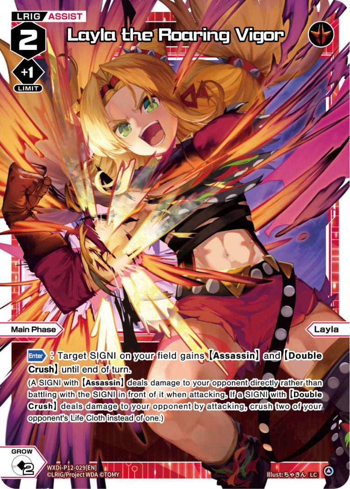

# Layla the Roaring Vigor

## Thông tin lá

| Trường | Giá trị |
| --- | --- |
| Mã in | WXDi-P12-029[EN] |
| Set | WXDi-P12[EN] |
| Số thứ tự | 029 |
| Loại thẻ | ASSIST LRIG |
| Vị trí | LRIG Deck |
| Số bản | — (set booster, không áp dụng) |
| Màu | Đỏ |
| Độ hiếm | LC,LC(P) |
| Minh họa | ちゃきん |
| Level | 2 |
| Limit | ＋１ |
| Power | 0 |
| LRIG type / Class | Layla |
| Team / Master | — |
| Cost | — |
| Grow cost | 《C》×２ |
| Use timing | Main Phase |
| Life Burst | Không |

## Card text chính thức

[Enter]: Target SIGNI on your field gains 【Assassin】 and 【Double Crush】 until end of turn.
(A SIGNI with 【Assassin】 deals damage to your opponent directly rather than battling with the SIGNI in front of it when attacking. If a SIGNI with 【Double Crush】 deals damage to your opponent by attacking, crush two of your opponent's Life Cloth instead of one.)

## Power text / Life Burst

—

## Ghi chú minh họa
Artist: ちゃきん. Ảnh LC được tải từ Card List tiếng Anh.

## FAQ chính thức

— (không có FAQ riêng cho mã này trên trang FAQ tiếng Anh.)

## Ảnh biến thể

- [LC(P)](../images/WXDi-P12-029P-EN.jpg)

## Nguồn
[Card List/FAQ chính thức](https://www.takaratomy.co.jp/products/en.wixoss/card/card.html?card_no=WXDi-P12-029%5BEN%5D ) · [Ảnh thẻ](https://www.takaratomy.co.jp/products/en.wixoss/card/thumb/WXDi-P12-029%5BEN%5D.jpg)
