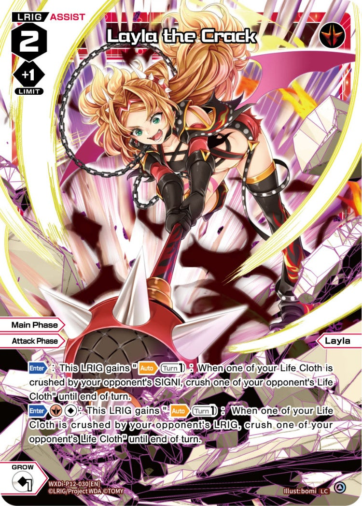

# Layla the Crack

## Thông tin lá

| Trường | Giá trị |
| --- | --- |
| Mã in | WXDi-P12-030[EN] |
| Set | WXDi-P12[EN] |
| Số thứ tự | 030 |
| Loại thẻ | ASSIST LRIG |
| Vị trí | LRIG Deck |
| Số bản | — (set booster, không áp dụng) |
| Màu | Đỏ |
| Độ hiếm | LC,LC(P) |
| Minh họa | bomi |
| Level | 2 |
| Limit | ＋１ |
| Power | 0 |
| LRIG type / Class | Layla |
| Team / Master | — |
| Cost | — |
| Grow cost | 《C》×１ |
| Use timing | Main Phase
Attack Phase |
| Life Burst | Không |

## Card text chính thức

[Enter]: This LRIG gains "[Auto] {1/Turn}: When one of your Life Cloth is crushed by your opponent's SIGNI, crush one of your opponent's Life Cloth" until end of turn.
[Enter] {Red} {Colorless}: This LRIG gains "[Auto] {1/Turn}: When one of your Life Cloth is crushed by your opponent's LRIG, crush one of your opponent's Life Cloth" until end of turn.

## Power text / Life Burst

—

## Ghi chú minh họa
Artist: bomi. Ảnh LC được tải từ Card List tiếng Anh.

## FAQ chính thức

**Q. After resolving the first [Enter] ability, if my Life Cloth is crushed by Life Burst of my opponent's SIGNI, does the [Auto] ability trigger?**
A. Yes, it is triggered. This effect is triggered when one of Life Cloth is crushed by a card that is not only a SIGNI on the field, but also Life Burst of your opponent's SIGNI.

## Ảnh biến thể

- [LC(P)](../images/WXDi-P12-030P-EN.jpg)

## Nguồn
[Card List/FAQ chính thức](https://www.takaratomy.co.jp/products/en.wixoss/card/card.html?card_no=WXDi-P12-030%5BEN%5D ) · [Ảnh thẻ](https://www.takaratomy.co.jp/products/en.wixoss/card/thumb/WXDi-P12-030%5BEN%5D.jpg)
