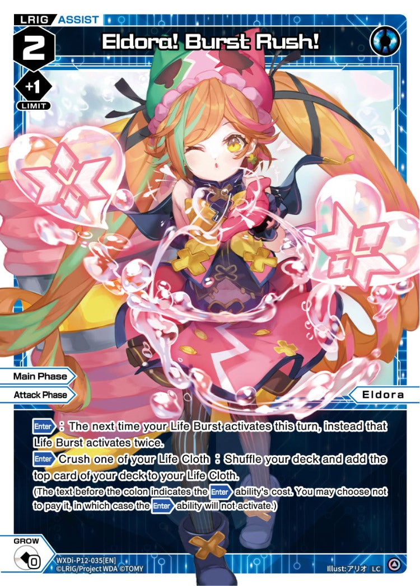

# Eldora! Burst Rush!

## Thông tin lá

| Trường | Giá trị |
| --- | --- |
| Mã in | WXDi-P12-035[EN] |
| Set | WXDi-P12[EN] |
| Số thứ tự | 035 |
| Loại thẻ | ASSIST LRIG |
| Vị trí | LRIG Deck |
| Số bản | — (set booster, không áp dụng) |
| Màu | Xanh dương |
| Độ hiếm | LC,LC(P) |
| Minh họa | アリオ |
| Level | 2 |
| Limit | ＋１ |
| Power | 0 |
| LRIG type / Class | Eldora |
| Team / Master | — |
| Cost | — |
| Grow cost | 《C》×０ |
| Use timing | Main Phase
Attack Phase |
| Life Burst | Không |

## Card text chính thức

[Enter]: The next time your Life Burst activates this turn, instead that Life Burst activates twice.
[Enter] Crush one of your Life Cloth: Shuffle your deck and add the top card of your deck to your Life Cloth.
(The text before the colon indicates the [Enter] ability's cost. You may choose not to pay it, in which case the [Enter] ability will not activate.)

## Power text / Life Burst

—

## Ghi chú minh họa
Artist: アリオ. Ảnh LC được tải từ Card List tiếng Anh.

## FAQ chính thức

**Q. What happens if a card with two Life Burst is crushed by some effect after the first [Enter] ability is resolved?**
A. In the case of a card with two Life Burst, each of those two triggers and resolves in turn. Only the first of the two triggered effects will be the one that is triggered twice by the card's [Enter] ability.

**Q. If I crush one of Life Cloth at the cost of the second [Enter] ability, does it trigger its Life Burst?**
A. Yes, it is triggered after this [Enter] ability resolves.

## Ảnh biến thể

- [LC(P)](../images/WXDi-P12-035P-EN.jpg)

## Nguồn
[Card List/FAQ chính thức](https://www.takaratomy.co.jp/products/en.wixoss/card/card.html?card_no=WXDi-P12-035%5BEN%5D ) · [Ảnh thẻ](https://www.takaratomy.co.jp/products/en.wixoss/card/thumb/WXDi-P12-035%5BEN%5D.jpg)
