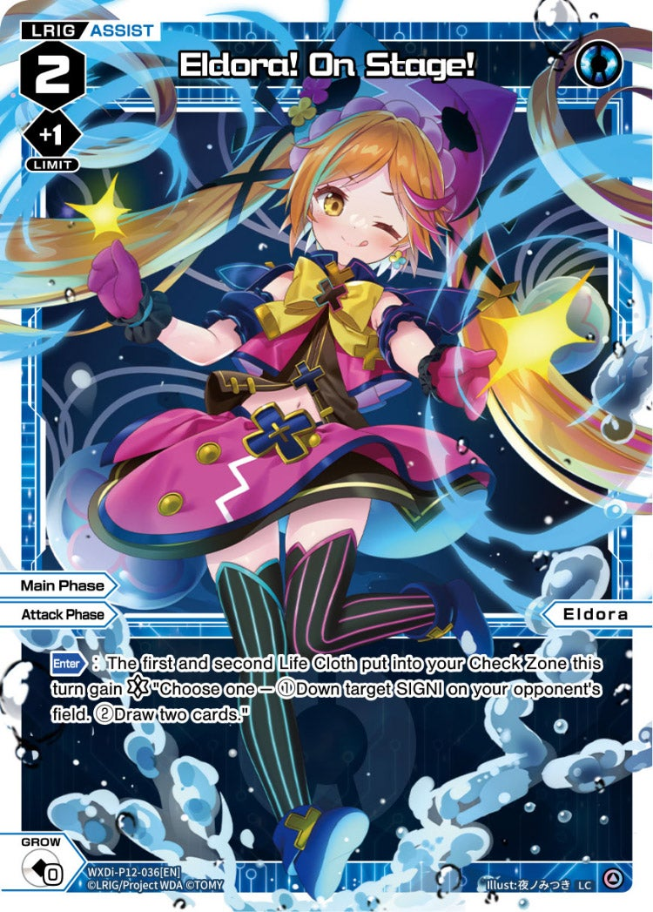

# Eldora! On Stage!

## Thông tin lá

| Trường | Giá trị |
| --- | --- |
| Mã in | WXDi-P12-036[EN] |
| Set | WXDi-P12[EN] |
| Số thứ tự | 036 |
| Loại thẻ | ASSIST LRIG |
| Vị trí | LRIG Deck |
| Số bản | — (set booster, không áp dụng) |
| Màu | Xanh dương |
| Độ hiếm | LC,LC(P) |
| Minh họa | 夜ノみつき |
| Level | 2 |
| Limit | ＋１ |
| Power | 0 |
| LRIG type / Class | Eldora |
| Team / Master | — |
| Cost | — |
| Grow cost | 《C》×０ |
| Use timing | Main Phase / Attack Phase |
| Life Burst | Không |

## Card text chính thức

[Enter]: The first and second Life Cloth put into your Check Zone this turn gain 【Life Burst】 "Choose one — ①Down target SIGNI on your opponent's field. ②Draw two cards."

## Power text / Life Burst

—

## Ghi chú minh họa
Artist: 夜ノみつき. Ảnh LC được tải từ Card List tiếng Anh.

## FAQ chính thức

**Q. After this [Enter] ability resolves, what happens if a card that originally had Life Burst is crushed and placed in the check zone?**
A. In that case, the Life Burst gained from that card’s effect and the original Life Burst are each triggered, so they can be resolved in order of preference. After both have resolved, the card is moved to the Ener Zone.

## Ảnh biến thể

- [LC(P)](../images/WXDi-P12-036P-EN.jpg)

## Nguồn
[Card List/FAQ chính thức](https://www.takaratomy.co.jp/products/en.wixoss/card/card.html?card_no=WXDi-P12-036%5BEN%5D ) · [Ảnh thẻ](https://www.takaratomy.co.jp/products/en.wixoss/card/thumb/WXDi-P12-036%5BEN%5D.jpg)
