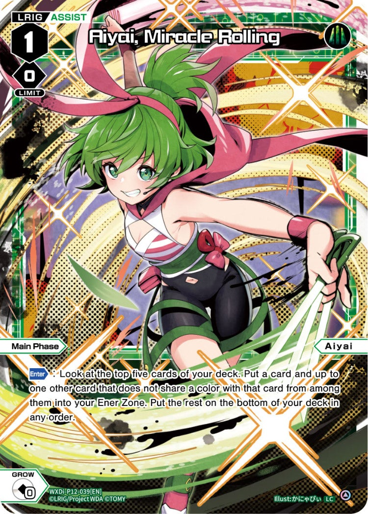

# Aiyai, Miracle Rolling

## Thông tin lá

| Trường | Giá trị |
| --- | --- |
| Mã in | WXDi-P12-039[EN] |
| Set | WXDi-P12[EN] |
| Số thứ tự | 039 |
| Loại thẻ | ASSIST LRIG |
| Vị trí | LRIG Deck |
| Số bản | — (set booster, không áp dụng) |
| Màu | Xanh lá |
| Độ hiếm | LC,LC(P) |
| Minh họa | かにゃぴぃ |
| Level | 1 |
| Limit | 0 |
| Power | 0 |
| LRIG type / Class | Aiyai |
| Team / Master | — |
| Cost | — |
| Grow cost | 《C》×０ |
| Use timing | Main Phase |
| Life Burst | Không |

## Card text chính thức

[Enter]: Look at the top five cards of your deck. Put a card and up to one other card that does not share a color with that card from among them into your Ener Zone. Put the rest on the bottom of your deck in any order.

## Power text / Life Burst

—

## Ghi chú minh họa
Artist: かにゃぴぃ. Ảnh LC được tải từ Card List tiếng Anh.

## FAQ chính thức

**Q. If I choose a colorless card such as 《Servant #》 for the first card, may I choose any card I want for the second card?**
A. Yes, colorless card has no color, so it has no color in common with any card, and as a result, the second card can be put in your Ener Zone of your choice. You can also put two 《Servant #》 cards in your Ener Zone.

## Ảnh biến thể

- [LC(P)](../images/WXDi-P12-039P-EN.jpg)

## Nguồn
[Card List/FAQ chính thức](https://www.takaratomy.co.jp/products/en.wixoss/card/card.html?card_no=WXDi-P12-039%5BEN%5D ) · [Ảnh thẻ](https://www.takaratomy.co.jp/products/en.wixoss/card/thumb/WXDi-P12-039%5BEN%5D.jpg)
