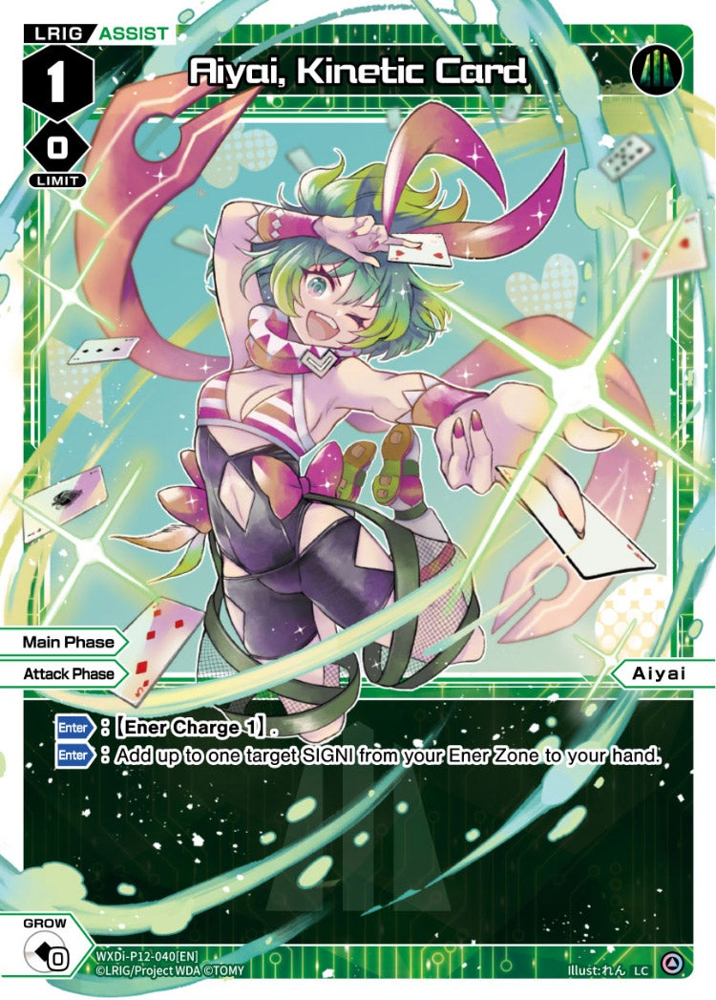

# Aiyai, Kinetic Card

## Thông tin lá

| Trường | Giá trị |
| --- | --- |
| Mã in | WXDi-P12-040[EN] |
| Set | WXDi-P12[EN] |
| Số thứ tự | 040 |
| Loại thẻ | ASSIST LRIG |
| Vị trí | LRIG Deck |
| Số bản | — (set booster, không áp dụng) |
| Màu | Xanh lá |
| Độ hiếm | LC,LC(P) |
| Minh họa | れん |
| Level | 1 |
| Limit | 0 |
| Power | 0 |
| LRIG type / Class | Aiyai |
| Team / Master | — |
| Cost | — |
| Grow cost | 《C》×０ |
| Use timing | Main Phase
Attack Phase |
| Life Burst | Không |

## Card text chính thức

[Enter]: 【Ener Charge 1】.
[Enter]: Add up to one target SIGNI from your Ener Zone to your hand.

## Power text / Life Burst

—

## Ghi chú minh họa
Artist: れん. Ảnh LC được tải từ Card List tiếng Anh.

## FAQ chính thức

**Q. May a card placed in the Ener Zone by the first [Enter] ability be added to my hand by the second [Enter] ability?**
A. Yes, it is possible. Multiple [Enter] abilities can be resolved in any order, so if you resolve the first ability followed by the second ability in that order, you can also target card put in the Ener Zone.

## Ảnh biến thể

- [LC(P)](../images/WXDi-P12-040P-EN.jpg)

## Nguồn
[Card List/FAQ chính thức](https://www.takaratomy.co.jp/products/en.wixoss/card/card.html?card_no=WXDi-P12-040%5BEN%5D ) · [Ảnh thẻ](https://www.takaratomy.co.jp/products/en.wixoss/card/thumb/WXDi-P12-040%5BEN%5D.jpg)
