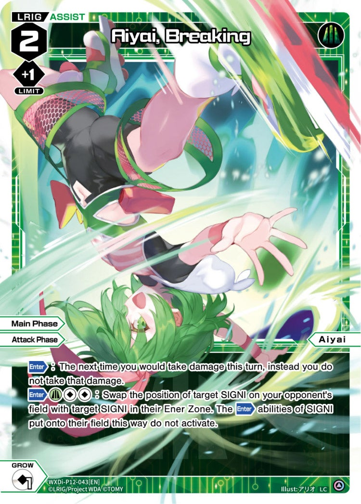

# Aiyai, Breaking

## Thông tin lá

| Trường | Giá trị |
| --- | --- |
| Mã in | WXDi-P12-043[EN] |
| Set | WXDi-P12[EN] |
| Số thứ tự | 043 |
| Loại thẻ | ASSIST LRIG |
| Vị trí | LRIG Deck |
| Số bản | — (set booster, không áp dụng) |
| Màu | Xanh lá |
| Độ hiếm | LC,LC(P) |
| Minh họa | アリオ |
| Level | 2 |
| Limit | ＋１ |
| Power | 0 |
| LRIG type / Class | Aiyai |
| Team / Master | — |
| Cost | — |
| Grow cost | 《C》×１ |
| Use timing | Main Phase / Attack Phase |
| Life Burst | Không |

## Card text chính thức

[Enter]: The next time you would take damage this turn, instead you do not take that damage.
[Enter] {Green} {Colorless} {Colorless}: Swap the position of target SIGNI on your opponent's field with target SIGNI in their Ener Zone. The [Enter] abilities of SIGNI put onto their field this way do not activate.

## Power text / Life Burst

—

## Ghi chú minh họa
Artist: アリオ. Ảnh LC được tải từ Card List tiếng Anh.

## FAQ chính thức

**Q. What happens if I use the second [Enter] ability to choose SIGNI in my opponent’s Ener Zone and that SIGNI level is higher than my opponents LRIG’s level?**
A. If you choose SIGNI that cannot normally be put on the field, it will not be put on the field and will not be replaced. The SIGNI that was on the field will remain on the field. For example, if you choose 【Rise】 SIGNI that put on top of SIGNI on the field, it cannot be replaced.

## Ảnh biến thể

- [LC(P)](../images/WXDi-P12-043P-EN.jpg)

## Nguồn
[Card List/FAQ chính thức](https://www.takaratomy.co.jp/products/en.wixoss/card/card.html?card_no=WXDi-P12-043%5BEN%5D ) · [Ảnh thẻ](https://www.takaratomy.co.jp/products/en.wixoss/card/thumb/WXDi-P12-043%5BEN%5D.jpg)
