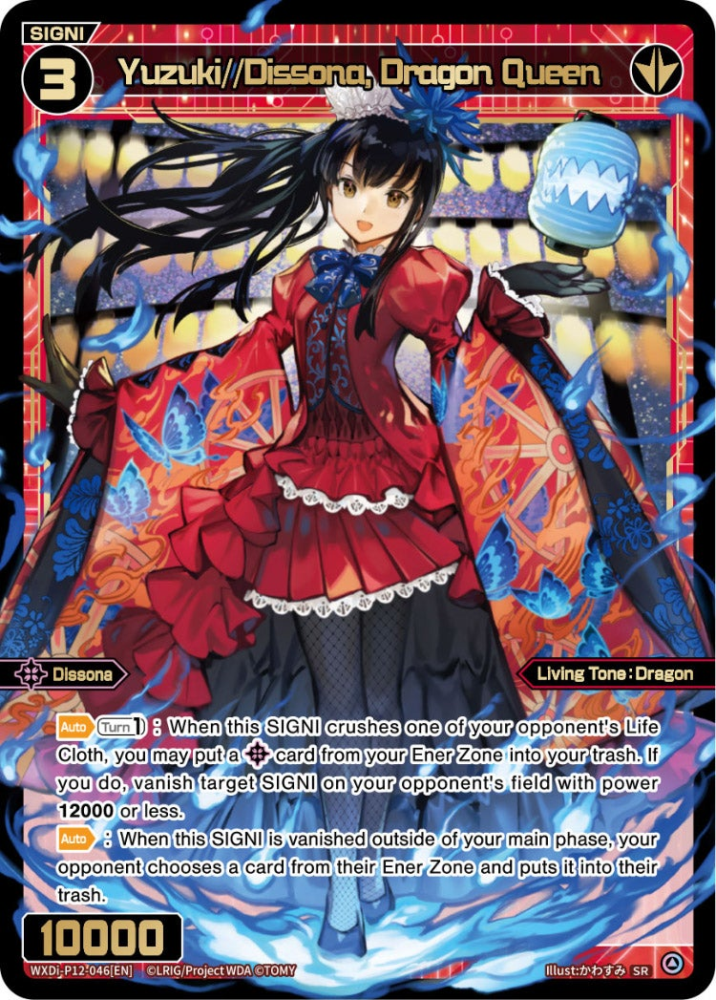

# Yuzuki//Dissona, Dragon Queen

## Thông tin lá

| Trường | Giá trị |
| --- | --- |
| Mã in | WXDi-P12-046[EN] |
| Set | WXDi-P12[EN] |
| Số thứ tự | 046 |
| Loại thẻ | SIGNI |
| Vị trí | Main Deck |
| Số bản | — (set booster, không áp dụng) |
| Màu | Đỏ |
| Độ hiếm | SR,SRP |
| Minh họa | かわすみ |
| Level | 3 |
| Limit | — |
| Power | 10000 |
| LRIG type / Class | Living Tone：Dragon |
| Team / Master | — |
| Cost | — |
| Grow cost | — |
| Use timing | — |
| Life Burst | Không |

## Card text chính thức

[Auto] {1/Turn}: When this SIGNI crushes one of your opponent's Life Cloth, you may put a {Dissona Icon} card from your Ener Zone into your trash. If you do, vanish target SIGNI on your opponent's field with power 12000 or less.
[Auto]: When this SIGNI is vanished outside of your main phase, your opponent chooses a card from their Ener Zone and puts it into their trash.

## Power text / Life Burst

—

## Ghi chú minh họa
Artist: かわすみ. Ảnh SR được tải từ Card List tiếng Anh.

## FAQ chính thức

**Q. If this SIGNI crushes my opponent's Life Cloth and it has Life Burst, which triggers first, this SIGNI's first [Auto] ability or Life Burst?**
A. It will be that SIGNI's [Auto] ability. Multiple trigger abilities are resolved starting on the turn player's side first.

## Ảnh biến thể

- [SRP](../images/WXDi-P12-046P-EN.jpg)

## Nguồn
[Card List/FAQ chính thức](https://www.takaratomy.co.jp/products/en.wixoss/card/card.html?card_no=WXDi-P12-046%5BEN%5D ) · [Ảnh thẻ](https://www.takaratomy.co.jp/products/en.wixoss/card/thumb/WXDi-P12-046%5BEN%5D.jpg)
