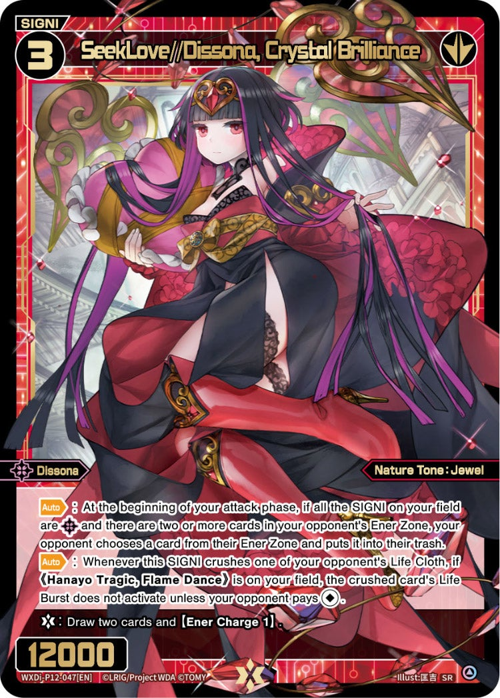

# SeekLove//Dissona, Crystal Brilliance

## Thông tin lá

| Trường | Giá trị |
| --- | --- |
| Mã in | WXDi-P12-047[EN] |
| Set | WXDi-P12[EN] |
| Số thứ tự | 047 |
| Loại thẻ | SIGNI |
| Vị trí | Main Deck |
| Số bản | — (set booster, không áp dụng) |
| Màu | Đỏ |
| Độ hiếm | SR,SRP |
| Minh họa | 匡吉 |
| Level | 3 |
| Limit | — |
| Power | 12000 |
| LRIG type / Class | Nature Tone：Jewel |
| Team / Master | — |
| Cost | — |
| Grow cost | — |
| Use timing | — |
| Life Burst | Có |

## Card text chính thức

[Auto]: At the beginning of your attack phase, if all the SIGNI on your field are {Dissona Icon} and there are two or more cards in your opponent's Ener Zone, your opponent chooses a card from their Ener Zone and puts it into their trash.
[Auto]: Whenever this SIGNI crushes one of your opponent's Life Cloth, if 《Hanayo Tragic, Flame Dance》 is on your field, the crushed card's Life Burst does not activate unless your opponent pays {Colorless}.

## Power text / Life Burst

Draw two cards and 【Ener Charge 1】.

## Ghi chú minh họa
Artist: 匡吉. Ảnh SR được tải từ Card List tiếng Anh.

## FAQ chính thức

**Q. When the first [Auto] ability is triggered,and there is only this SIGNI on my field, is the condition met?**
A. Yes, in this case the condition is met, even if there is only one, as long as it is SIGNI with {Dissona Icon}. It is not necessary to have a SIGNI with {Dissona Icon} in all SIGNI zones.

**Q. If this SIGNI gains 【Double Crush】 and crushes two of my opponent's Life Cloth, what happens to the second [Auto] ability?**
A. For each crush, that SIGNI's second [Auto] ability is triggered; if your opponent wants to trigger two cards Life Burst, your opponent must pay {colorless} {colorless}.

## Ảnh biến thể

- [SRP](../images/WXDi-P12-047P-EN.jpg)

## Nguồn
[Card List/FAQ chính thức](https://www.takaratomy.co.jp/products/en.wixoss/card/card.html?card_no=WXDi-P12-047%5BEN%5D ) · [Ảnh thẻ](https://www.takaratomy.co.jp/products/en.wixoss/card/thumb/WXDi-P12-047%5BEN%5D.jpg)
