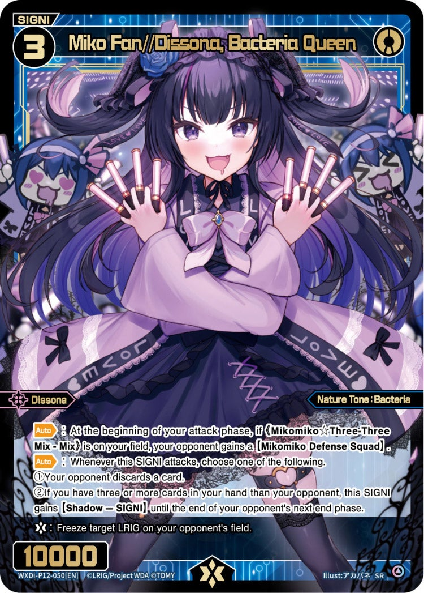

# Miko Fan//Dissona, Bacteria Queen

## Thông tin lá

| Trường | Giá trị |
| --- | --- |
| Mã in | WXDi-P12-050[EN] |
| Set | WXDi-P12[EN] |
| Số thứ tự | 050 |
| Loại thẻ | SIGNI |
| Vị trí | Main Deck |
| Số bản | — (set booster, không áp dụng) |
| Màu | Xanh dương |
| Độ hiếm | SR,SRP |
| Minh họa | アカバネ |
| Level | 3 |
| Limit | — |
| Power | 10000 |
| LRIG type / Class | Nature Tone：Bacteria |
| Team / Master | — |
| Cost | — |
| Grow cost | — |
| Use timing | — |
| Life Burst | Có |

## Card text chính thức

[Auto]: At the beginning of your attack phase, if 《Mikomiko☆Three - Three Mix - Mix》 is on your field, your opponent gains a 【Mikomiko Defense Squad】.
[Auto]: Whenever this SIGNI attacks, choose one of the following.
①Your opponent discards a card.
②If you have three or more cards in your hand than your opponent, this SIGNI gains 【Shadow — SIGNI】 until the end of your opponent's next end phase.

## Power text / Life Burst

Freeze target LRIG on your opponent's field.

## Ghi chú minh họa
Artist: アカバネ. Ảnh SR được tải từ Card List tiếng Anh.

## FAQ chính thức

**Q. What should I do if I gain 【Mikomiko Defense Squad】?**
A. Please place markers where we can see each one, so that we know your opponent has the 【Mikomiko Defense Squad】 and they do not get mixed up in decks, etc.

**Q. May I gain more than one 【Mikomiko Defense Squad】?**
A. Yes, you may gain more than one. In that case, each [Auto] ability is triggered separately.

## Ảnh biến thể

- [SRP](../images/WXDi-P12-050P-EN.jpg)

## Nguồn
[Card List/FAQ chính thức](https://www.takaratomy.co.jp/products/en.wixoss/card/card.html?card_no=WXDi-P12-050%5BEN%5D ) · [Ảnh thẻ](https://www.takaratomy.co.jp/products/en.wixoss/card/thumb/WXDi-P12-050%5BEN%5D.jpg)
