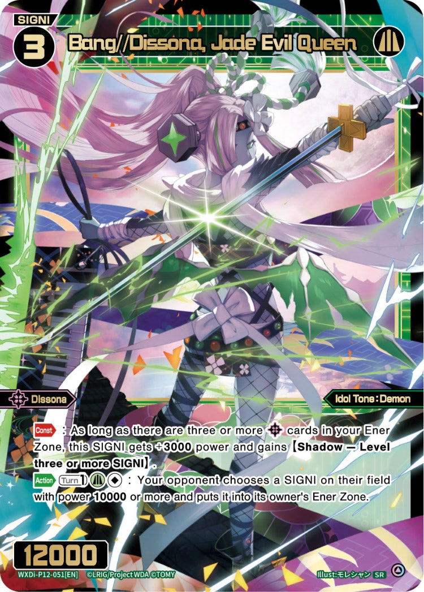

# Bang//Dissona, Jade Evil Queen

## Thông tin lá

| Trường | Giá trị |
| --- | --- |
| Mã in | WXDi-P12-051[EN] |
| Set | WXDi-P12[EN] |
| Số thứ tự | 051 |
| Loại thẻ | SIGNI |
| Vị trí | Main Deck |
| Số bản | — (set booster, không áp dụng) |
| Màu | Xanh lá |
| Độ hiếm | SR,SRP |
| Minh họa | モレシャン |
| Level | 3 |
| Limit | — |
| Power | 12000 |
| LRIG type / Class | Idol Tone：Demon |
| Team / Master | — |
| Cost | — |
| Grow cost | — |
| Use timing | — |
| Life Burst | Không |

## Card text chính thức

[Constant]: As long as there are three or more {Dissona Icon} cards in your Ener Zone, this SIGNI gets +3000 power and gains 【Shadow — Level three or more SIGNI】.
[Action] {1/Turn} {Green} {Colorless}: Your opponent chooses a SIGNI on their field with power 10000 or more and puts it into its owner's Ener Zone.

## Power text / Life Burst

—

## Ghi chú minh họa
Artist: モレシャン. Ảnh SR được tải từ Card List tiếng Anh.

## FAQ chính thức

**Q. If this card gains 【Shadow - (Level three or more SIGNI)】, can this card targeted by the Life Burst effect of a level three or higher SIGNI?**
A. No. If it is a card of a level three or higher SIGNI, even if it is a Life Burst, it is not target by the effect.

**Q. If my opponent chooses their 《Exia, Blessed Angel Queen》 by the [Action] ability, does the [Auto] ability of 《Exia, Blessed Angel Queen》 trigger?**
A. No, it does not trigger. That card's tirggered ability does not target SIGNI.

**Q. May my opponent choose their SIGNI with [Shadow] by this card's [Action] ability?**
A. Yes, your opponent can choose. 【Shadow】 is an effect that is no longer targeted by the opponent's effect, but this card's [Action] ability does not target SIGNI.

## Ảnh biến thể

- [SRP](../images/WXDi-P12-051P-EN.jpg)

## Nguồn
[Card List/FAQ chính thức](https://www.takaratomy.co.jp/products/en.wixoss/card/card.html?card_no=WXDi-P12-051%5BEN%5D ) · [Ảnh thẻ](https://www.takaratomy.co.jp/products/en.wixoss/card/thumb/WXDi-P12-051%5BEN%5D.jpg)
