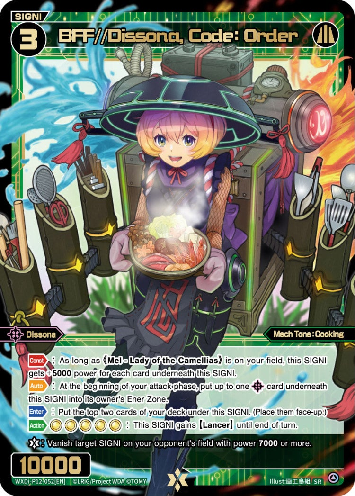

# BFF//Dissona, Code: Order

## Thông tin lá

| Trường | Giá trị |
| --- | --- |
| Mã in | WXDi-P12-052[EN] |
| Set | WXDi-P12[EN] |
| Số thứ tự | 052 |
| Loại thẻ | SIGNI |
| Vị trí | Main Deck |
| Số bản | — (set booster, không áp dụng) |
| Màu | Xanh lá |
| Độ hiếm | SR,SRP |
| Minh họa | 画工鳥組 |
| Level | 3 |
| Limit | — |
| Power | 10000 |
| LRIG type / Class | Mech Tone：Cooking |
| Team / Master | — |
| Cost | — |
| Grow cost | — |
| Use timing | — |
| Life Burst | Có |

## Card text chính thức

[Constant]: As long as 《Mel - Lady of the Camellias》 is on your field, this SIGNI gets +5000 power for each card underneath this SIGNI.
[Auto]: At the beginning of your attack phase, put up to one {Dissona Icon} card underneath this SIGNI into its owner's Ener Zone.
[Enter]: Put the top two cards of your deck under this SIGNI. (Place them face-up.)
[Action] {Coin Icon} {Coin Icon} {Coin Icon} {Coin Icon} {Coin Icon}: This SIGNI gains 【Lancer】 until end of turn.

## Power text / Life Burst

Vanish target SIGNI on your opponent's field with power 7000 or more.

## Ghi chú minh họa
Artist: 画工鳥組. Ảnh SR được tải từ Card List tiếng Anh.

## FAQ chính thức

**Q. If this SIGNI leaves the field, what happens to the cards that were underneath?**
A. They are put into the trash by the Rule-based action.

## Ảnh biến thể

- [SRP](../images/WXDi-P12-052P-EN.jpg)

## Nguồn
[Card List/FAQ chính thức](https://www.takaratomy.co.jp/products/en.wixoss/card/card.html?card_no=WXDi-P12-052%5BEN%5D ) · [Ảnh thẻ](https://www.takaratomy.co.jp/products/en.wixoss/card/thumb/WXDi-P12-052%5BEN%5D.jpg)
