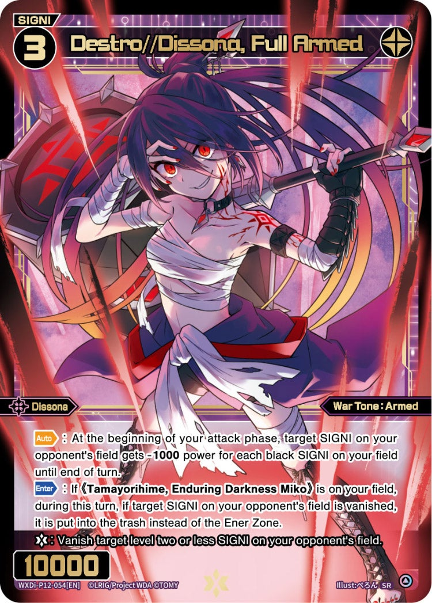

# Destro//Dissona, Full Armed

## Thông tin lá

| Trường | Giá trị |
| --- | --- |
| Mã in | WXDi-P12-054[EN] |
| Set | WXDi-P12[EN] |
| Số thứ tự | 054 |
| Loại thẻ | SIGNI |
| Vị trí | Main Deck |
| Số bản | — (set booster, không áp dụng) |
| Màu | Đen |
| Độ hiếm | SR,SRP |
| Minh họa | ぺろん |
| Level | 3 |
| Limit | — |
| Power | 10000 |
| LRIG type / Class | War Tone：Armed |
| Team / Master | — |
| Cost | — |
| Grow cost | — |
| Use timing | — |
| Life Burst | Có |

## Card text chính thức

[Auto]: At the beginning of your attack phase, target SIGNI on your opponent's field gets -1000 power for each black SIGNI on your field until end of turn.
[Enter]: If 《Tamayorihime, Enduring Darkness Miko》 is on your field, during this turn, if target SIGNI on your opponent's field is vanished, it is put into the trash instead of the Ener Zone.

## Power text / Life Burst

Vanish target level two or less SIGNI on your opponent's field.

## Ghi chú minh họa
Artist: ぺろん. Ảnh SR được tải từ Card List tiếng Anh.

## FAQ chính thức

— (không có FAQ riêng cho mã này trên trang FAQ tiếng Anh.)

## Ảnh biến thể

- [SRP](../images/WXDi-P12-054P-EN.jpg)

## Nguồn
[Card List/FAQ chính thức](https://www.takaratomy.co.jp/products/en.wixoss/card/card.html?card_no=WXDi-P12-054%5BEN%5D ) · [Ảnh thẻ](https://www.takaratomy.co.jp/products/en.wixoss/card/thumb/WXDi-P12-054%5BEN%5D.jpg)
