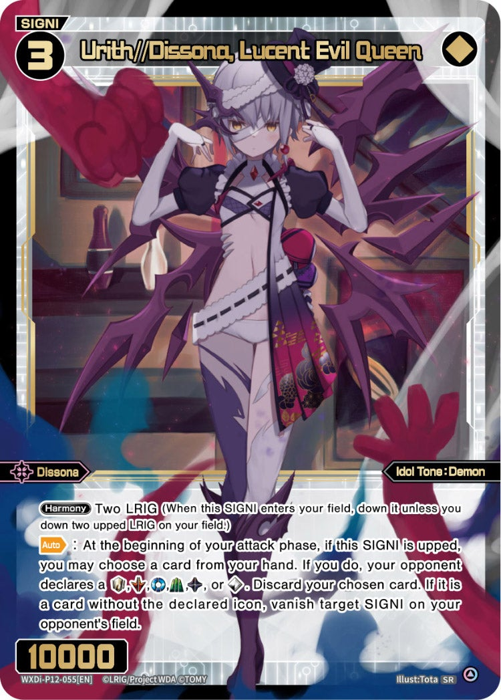

# Urith//Dissona, Lucent Evil Queen

## Thông tin lá

| Trường | Giá trị |
| --- | --- |
| Mã in | WXDi-P12-055[EN] |
| Set | WXDi-P12[EN] |
| Số thứ tự | 055 |
| Loại thẻ | SIGNI |
| Vị trí | Main Deck |
| Số bản | — (set booster, không áp dụng) |
| Màu | Không màu |
| Độ hiếm | SR,SRP |
| Minh họa | Tota |
| Level | 3 |
| Limit | — |
| Power | 10000 |
| LRIG type / Class | Idol Tone：Demon |
| Team / Master | — |
| Cost | — |
| Grow cost | — |
| Use timing | — |
| Life Burst | Không |

## Card text chính thức

[Harmony] Two LRIG (When this SIGNI enters your field, down it unless you down two upped LRIG on your field.)
[Auto]: At the beginning of your attack phase, if this SIGNI is upped, you may choose a card from your hand. If you do, your opponent declares a {White2}, {Red2}, {Blue2}, {Green2}, {Black2}, or {Colorless2}. Discard your chosen card. If it is a card without the declared icon, vanish target SIGNI on your opponent's field.

## Power text / Life Burst

—

## Ghi chú minh họa
Artist: Tota. Ảnh SR được tải từ Card List tiếng Anh.

## FAQ chính thức

**Q. What is 【Harmony】?**
A. When a SIGNI with 【Harmony】 enters the field, it will be downed unless it downs an LRIG that meets the requirements. If you have a LIRG that meets the requirements, you can also choose to down this SIGNI. Since 【Harmony】 is not an [Enter] ability, it will also trigger when it enters the field with the effect "The [Enter] abilities do not activate.".

## Ảnh biến thể

- [SRP](../images/WXDi-P12-055P-EN.jpg)

## Nguồn
[Card List/FAQ chính thức](https://www.takaratomy.co.jp/products/en.wixoss/card/card.html?card_no=WXDi-P12-055%5BEN%5D ) · [Ảnh thẻ](https://www.takaratomy.co.jp/products/en.wixoss/card/thumb/WXDi-P12-055%5BEN%5D.jpg)
