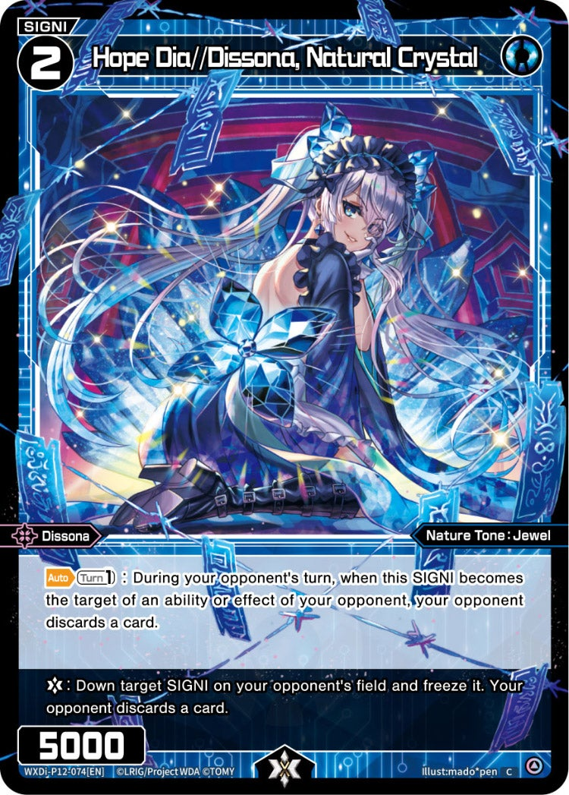

# Hope Dia//Dissona, Natural Crystal

## Thông tin lá

| Trường | Giá trị |
| --- | --- |
| Mã in | WXDi-P12-074[EN] |
| Set | WXDi-P12[EN] |
| Số thứ tự | 074 |
| Loại thẻ | SIGNI |
| Vị trí | Main Deck |
| Số bản | — (set booster, không áp dụng) |
| Màu | Xanh dương |
| Độ hiếm | C,C(P) |
| Minh họa | mado*pen |
| Level | 2 |
| Limit | — |
| Power | 5000 |
| LRIG type / Class | Nature Tone：Jewel |
| Team / Master | — |
| Cost | — |
| Grow cost | — |
| Use timing | — |
| Life Burst | Có |

## Card text chính thức

[Auto] {1/Turn}: During your opponent's turn, when this SIGNI becomes the target of an ability or effect of your opponent, your opponent discards a card.

## Power text / Life Burst

Down target SIGNI on your opponent's field and freeze it. Your opponent discards a card.

## Ghi chú minh họa
Artist: mado*pen. Ảnh C được tải từ Card List tiếng Anh.

## FAQ chính thức

**Q. My opponent's effect of "vanish target SIGNI" targets this SIGNI and it is vanished. Does the [Auto] ability trigger?**
A. Yes,it is triggered. The ability is triggered as soon as it is targeted, and the triggered ability resolves even if the original SIGNI is subsequently moved.

## Ảnh biến thể

- [C(P)](../images/WXDi-P12-074P-EN.jpg)

## Nguồn
[Card List/FAQ chính thức](https://www.takaratomy.co.jp/products/en.wixoss/card/card.html?card_no=WXDi-P12-074%5BEN%5D ) · [Ảnh thẻ](https://www.takaratomy.co.jp/products/en.wixoss/card/thumb/WXDi-P12-074%5BEN%5D.jpg)
