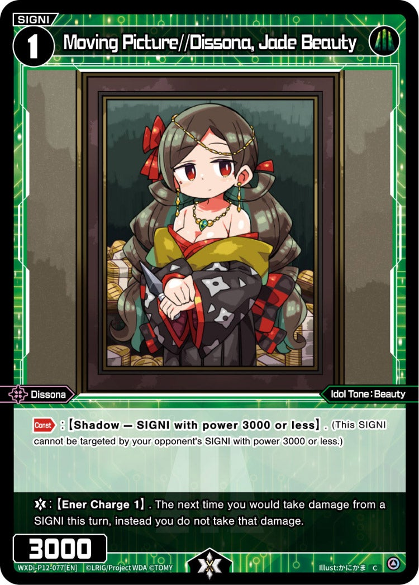

# Moving Picture//Dissona, Jade Beauty

## Thông tin lá

| Trường | Giá trị |
| --- | --- |
| Mã in | WXDi-P12-077[EN] |
| Set | WXDi-P12[EN] |
| Số thứ tự | 077 |
| Loại thẻ | SIGNI |
| Vị trí | Main Deck |
| Số bản | — (set booster, không áp dụng) |
| Màu | Xanh lá |
| Độ hiếm | C,C(P) |
| Minh họa | かにかま |
| Level | 1 |
| Limit | — |
| Power | 3000 |
| LRIG type / Class | Idol Tone：Beauty |
| Team / Master | — |
| Cost | — |
| Grow cost | — |
| Use timing | — |
| Life Burst | Có |

## Card text chính thức

[Constant]: 【Shadow — SIGNI with power 3000 or less】. (This SIGNI cannot be targeted by your opponent's SIGNI with power 3000 or less.)

## Power text / Life Burst

【Ener Charge 1】. The next time you would take damage from a SIGNI this turn, instead you do not take that damage.

## Ghi chú minh họa
Artist: かにかま. Ảnh C được tải từ Card List tiếng Anh.

## FAQ chính thức

**Q. Can this SIGNI be targeted by the Life Burst effect of a power 3000 or less SIGNI?**
A. No. If it is a card of a power 3000 or less SIGNI, even if it is a Life Burst, it cannot be target by the effect.

## Ảnh biến thể

- [C(P)](../images/WXDi-P12-077P-EN.jpg)

## Nguồn
[Card List/FAQ chính thức](https://www.takaratomy.co.jp/products/en.wixoss/card/card.html?card_no=WXDi-P12-077%5BEN%5D ) · [Ảnh thẻ](https://www.takaratomy.co.jp/products/en.wixoss/card/thumb/WXDi-P12-077%5BEN%5D.jpg)
