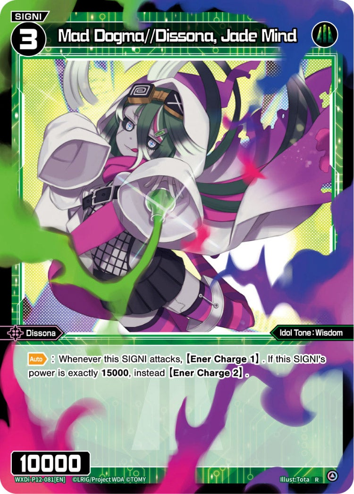

# Mad Dogma//Dissona, Jade Mind

## Thông tin lá

| Trường | Giá trị |
| --- | --- |
| Mã in | WXDi-P12-081[EN] |
| Set | WXDi-P12[EN] |
| Số thứ tự | 081 |
| Loại thẻ | SIGNI |
| Vị trí | Main Deck |
| Số bản | — (set booster, không áp dụng) |
| Màu | Xanh lá |
| Độ hiếm | R,R(P) |
| Minh họa | Tota |
| Level | 3 |
| Limit | — |
| Power | 10000 |
| LRIG type / Class | Idol Tone：Wisdom |
| Team / Master | — |
| Cost | — |
| Grow cost | — |
| Use timing | — |
| Life Burst | Không |

## Card text chính thức

[Auto]: Whenever this SIGNI attacks, 【Ener Charge 1】. If this SIGNI's power is exactly 15000, instead 【Ener Charge 2】.

## Power text / Life Burst

—

## Ghi chú minh họa
Artist: Tota. Ảnh R được tải từ Card List tiếng Anh.

## FAQ chính thức

**Q. If this SIGNI's power exceeds 15000, can it be 【Ener Chage 2】?**
A. Yes, power must be exactly 15000.

## Ảnh biến thể

- [R(P)](../images/WXDi-P12-081P-EN.jpg)

## Nguồn
[Card List/FAQ chính thức](https://www.takaratomy.co.jp/products/en.wixoss/card/card.html?card_no=WXDi-P12-081%5BEN%5D ) · [Ảnh thẻ](https://www.takaratomy.co.jp/products/en.wixoss/card/thumb/WXDi-P12-081%5BEN%5D.jpg)
