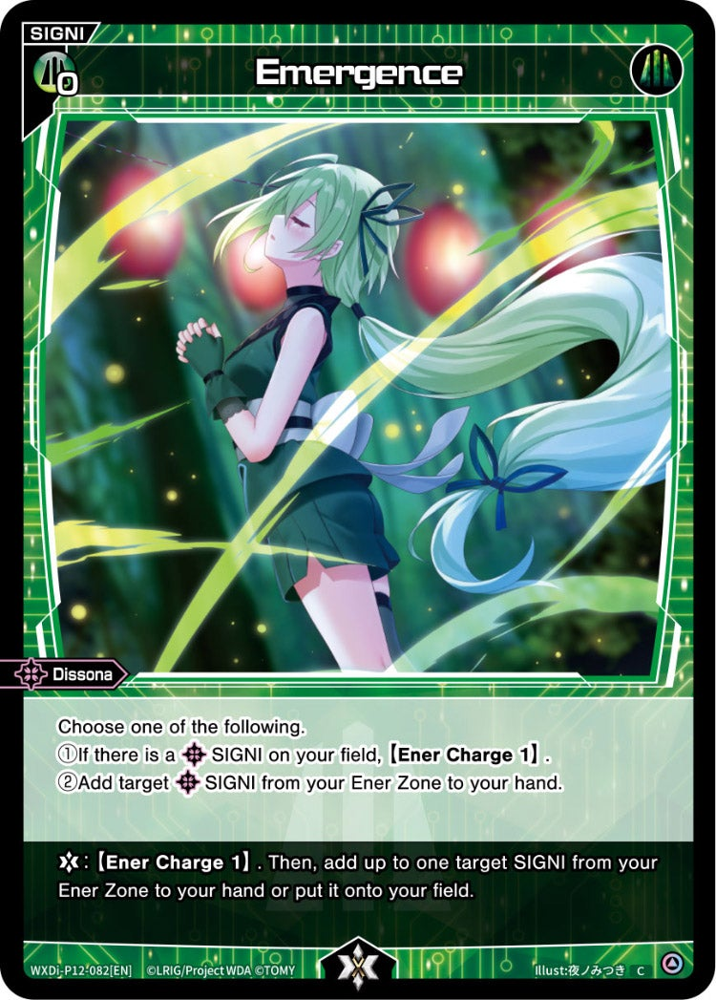

# Emergence

## Thông tin lá

| Trường | Giá trị |
| --- | --- |
| Mã in | WXDi-P12-082[EN] |
| Set | WXDi-P12[EN] |
| Số thứ tự | 082 |
| Loại thẻ | SPELL |
| Vị trí | Main Deck |
| Số bản | — (set booster, không áp dụng) |
| Màu | Xanh lá |
| Độ hiếm | C,C(P) |
| Minh họa | 夜ノみつき |
| Level | — |
| Limit | — |
| Power | 0 |
| LRIG type / Class | — |
| Team / Master | — |
| Cost | 《G》×０ |
| Grow cost | — |
| Use timing | — |
| Life Burst | Có |

## Card text chính thức

Choose one of the following.
①If there is a {Dissona Icon} SIGNI on your field, 【Ener Charge 1】.
②Add target {Dissona Icon} SIGNI from your Ener Zone to your hand.

## Power text / Life Burst

【Ener Charge 1】. Then, add up to one target SIGNI from your Ener Zone to your hand or put it onto your field.

## Ghi chú minh họa
Artist: 夜ノみつき. Ảnh C được tải từ Card List tiếng Anh.

## FAQ chính thức

— (không có FAQ riêng cho mã này trên trang FAQ tiếng Anh.)

## Ảnh biến thể

- [C(P)](../images/WXDi-P12-082P-EN.jpg)

## Nguồn
[Card List/FAQ chính thức](https://www.takaratomy.co.jp/products/en.wixoss/card/card.html?card_no=WXDi-P12-082%5BEN%5D ) · [Ảnh thẻ](https://www.takaratomy.co.jp/products/en.wixoss/card/thumb/WXDi-P12-082%5BEN%5D.jpg)
