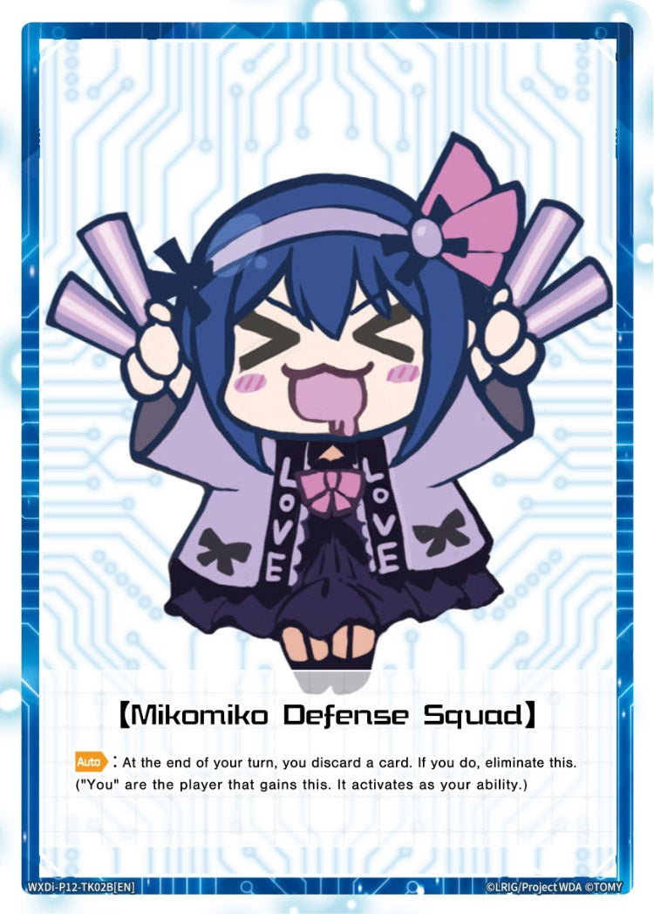

# 【Mikomiko Defense Squad】

## Thông tin lá

| Trường | Giá trị |
| --- | --- |
| Mã in | WXDi-P12-TK02B[EN] |
| Set | WXDi-P12[EN] |
| Số thứ tự | TK02B |
| Loại thẻ | TOKEN |
| Vị trí | Ngoài deck (token/special) |
| Số bản | — (set booster, không áp dụng) |
| Màu | — |
| Độ hiếm | TK,TK(P) |
| Minh họa | — |
| Level | — |
| Limit | — |
| Power | 0 |
| LRIG type / Class | — |
| Team / Master | — |
| Cost | — |
| Grow cost | — |
| Use timing | — |
| Life Burst | Không |

## Card text chính thức

[Auto]: At the end of your turn, discard a card. If you do, eliminate this.
("You" are the player that gains this. It activates as your ability.)

## Power text / Life Burst

—

## Ghi chú minh họa
Artist: -. Ảnh TK được tải từ Card List tiếng Anh.

Đây là lá token/coin/special đi kèm sản phẩm, không phải lá thường trong bộ chính.

## FAQ chính thức

— (không có FAQ riêng cho mã này trên trang FAQ tiếng Anh.)

## Ảnh biến thể

- [TK](../images/WXDi-P12-TK02BP-EN.jpg)

## Nguồn
[Card List/FAQ chính thức](https://www.takaratomy.co.jp/products/en.wixoss/card/card.html?card_no=WXDi-P12-TK02B%5BEN%5D ) · [Ảnh thẻ](https://www.takaratomy.co.jp/products/en.wixoss/card/thumb/WXDi-P12-TK02B%5BEN%5D.jpg)
