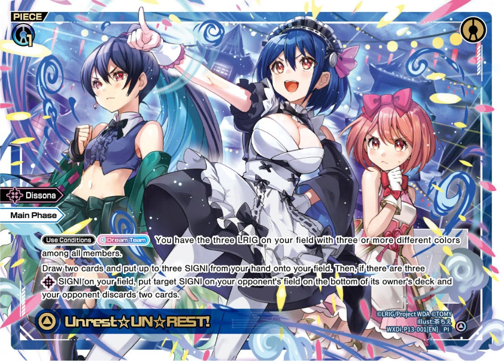

# Unrest☆UN☆REST!

## Thông tin lá

| Trường | Giá trị |
| --- | --- |
| Mã in | WXDi-P13-001[EN] |
| Set | WXDi-P13[EN] |
| Số thứ tự | 001 |
| Loại thẻ | PIECE |
| Vị trí | LRIG Deck |
| Số bản | — (set booster, không áp dụng) |
| Màu | Xanh dương |
| Độ hiếm | PI,LRP |
| Minh họa | 茶ちえ |
| Level | — |
| Limit | — |
| Power | 0 |
| LRIG type / Class | — |
| Team / Master | — |
| Cost | 《U》×１ |
| Grow cost | — |
| Use timing | Main Phase |
| Life Burst | Không |

## Card text chính thức

[Use Conditions] [Dream Team] You have the three LRIG on your field with three or more different colors among all members.

Draw two cards and put up to three SIGNI from your hand onto your field. Then, if there are three {Dissona Icon} SIGNI on your field, put target SIGNI on your opponent's field on the bottom of its owner's deck and your opponent discards two cards.

## Power text / Life Burst

—

## Ghi chú minh họa
Artist: 茶ちえ. Ảnh PI được tải từ Card List tiếng Anh.

## FAQ chính thức

**Q. When does the [Enter] abilities of the SIGNI that was put them (can be deleted) onto my field from my hand by the effect of this PIECE trigger?**
A. After all the effects of this PIECE are resolved, you can resolve the triggered abilities in any order, including the [Enter] abilities of the SIGNI you put them (can be deleted) onto your field.

**Q. May the effect of this card make my opponent discard two cards from their hand if my opponent has no SIGNI on the field?**
A. Yes, if the conditions are met, your opponent discards two cards from their hand, even if there are no SIGNI on your opponent's field.

## Ảnh biến thể

- [LRP](../images/WXDi-P13-001P-EN.jpg)

## Nguồn
[Card List/FAQ chính thức](https://www.takaratomy.co.jp/products/en.wixoss/card/card.html?card_no=WXDi-P13-001%5BEN%5D ) · [Ảnh thẻ](https://www.takaratomy.co.jp/products/en.wixoss/card/thumb/WXDi-P13-001%5BEN%5D.jpg)
