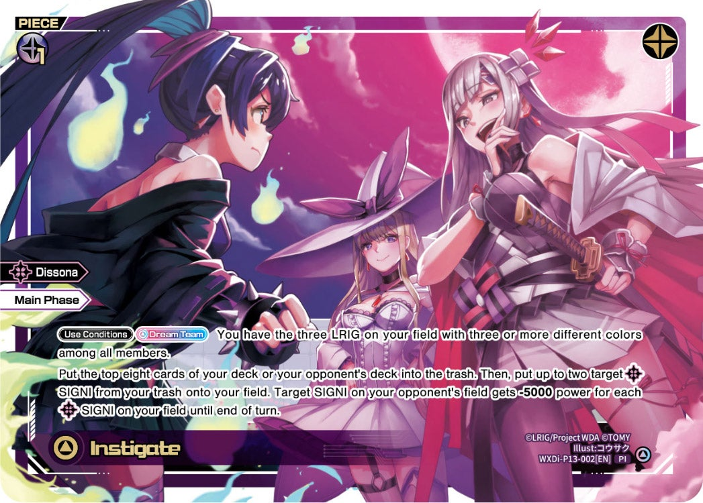

# Instigate

## Thông tin lá

| Trường | Giá trị |
| --- | --- |
| Mã in | WXDi-P13-002[EN] |
| Set | WXDi-P13[EN] |
| Số thứ tự | 002 |
| Loại thẻ | PIECE |
| Vị trí | LRIG Deck |
| Số bản | — (set booster, không áp dụng) |
| Màu | Đen |
| Độ hiếm | PI,LRP |
| Minh họa | コウサク |
| Level | — |
| Limit | — |
| Power | 0 |
| LRIG type / Class | — |
| Team / Master | — |
| Cost | 《B》×１ |
| Grow cost | — |
| Use timing | Main Phase |
| Life Burst | Không |

## Card text chính thức

[Use Conditions] [Dream Team] You have the three LRIG on your field with three or more different colors among all members.

Put the top eight cards of your deck or your opponent's deck into the trash. Then, put up to two target {Dissona Icon} SIGNI from your trash onto your field. Target SIGNI on your opponent's field gets -5000 power for each {Dissona Icon} SIGNI on your field until end of turn.

## Power text / Life Burst

—

## Ghi chú minh họa
Artist: コウサク. Ảnh PI được tải từ Card List tiếng Anh.

## FAQ chính thức

**Q. What happens if I have eight or less cards in my deck and I choose to put eight cards from the top of my deck into the trash by this PIECE?**
A. In this case, first put all remaining decks of eight cards or less into the trash. Your deck will be reduced to zero cards, but first process all the effects of this PIECE. After the effect of the PIECE is resolved, perform a Rule-based Action check and if the deck is zero cards, perform a refresh.

**Q. As putting two SIGNI with {Dissona Icon} from the my hand, may I choose one SIGNI with [Rise] and one SIGNI whose condition is required for that Rise, and put one SIGNI with [Rise] on top of it after first putting one SIGNI whose condition is required for Rise?**
A. No, you cannot. The two SIGNI are put at the same time. SIGNI with [Rise] must meet the Rise condition, except for SIGNI that are put at the same time.

**Q. When do I choose the target of SIGNI to be put on the field from my trash or my opponent's SIGNI?**
A. You can choose after the first effect of "putting top eight cards of your deck into the trash".

## Ảnh biến thể

- [LRP](../images/WXDi-P13-002P-EN.jpg)

## Nguồn
[Card List/FAQ chính thức](https://www.takaratomy.co.jp/products/en.wixoss/card/card.html?card_no=WXDi-P13-002%5BEN%5D ) · [Ảnh thẻ](https://www.takaratomy.co.jp/products/en.wixoss/card/thumb/WXDi-P13-002%5BEN%5D.jpg)
