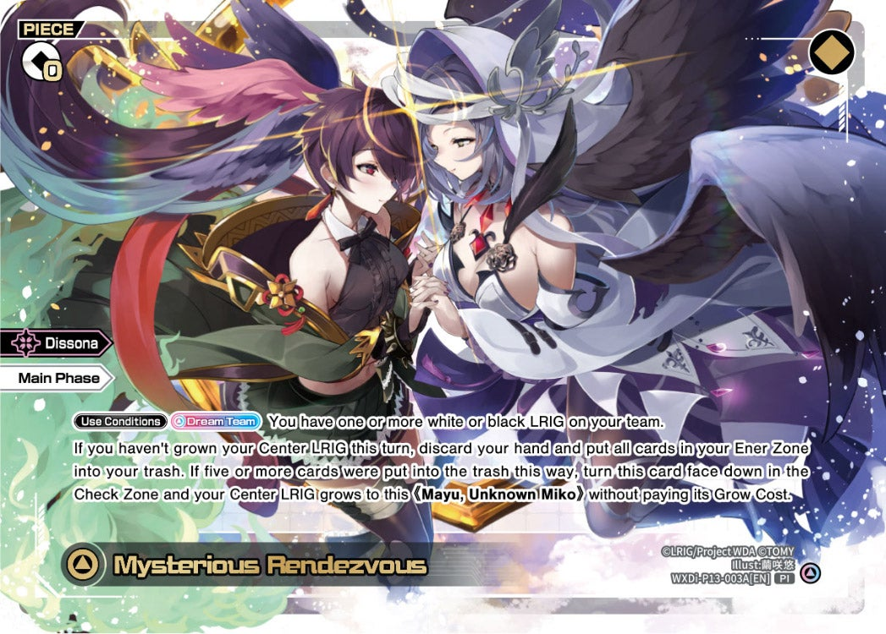

# Mysterious Rendezvous

## Thông tin lá

| Trường | Giá trị |
| --- | --- |
| Mã in | WXDi-P13-003A[EN] |
| Set | WXDi-P13[EN] |
| Số thứ tự | 003A |
| Loại thẻ | PIECE |
| Vị trí | LRIG Deck |
| Số bản | — (set booster, không áp dụng) |
| Màu | Không màu |
| Độ hiếm | PI,LRP,UR,SP |
| Minh họa | 繭咲悠 |
| Level | — |
| Limit | — |
| Power | 0 |
| LRIG type / Class | — |
| Team / Master | — |
| Cost | 《C》×０ |
| Grow cost | — |
| Use timing | Main Phase |
| Life Burst | Không |

## Card text chính thức

[Use Conditions] [Dream Team] You have one or more white or black LRIG on your team.

If you haven't grown your Center LRIG this turn, discard your hand and put all cards in your Ener Zone into your trash. If five or more cards were put into the trash this way, turn this card face down in the Check Zone and your Center LRIG grows to this 《Mayu, Unknown Miko》 without paying its Grow Cost.

## Power text / Life Burst

—

## Ghi chú minh họa
Artist: 繭咲悠. Ảnh PI được tải từ Card List tiếng Anh.

## FAQ chính thức

**Q. Is this card treated as both PIECE and SIGNI when it is in the LRIG deck?**
A. No, this card is treated as an A-side PIECE when in the LRIG deck and not as SIGNI.

**Q. What happens if I use this PIECE if the center LRIG is not a <Tama> or <Iona>, or if the center LRIG is not level three, for example, if it does not meet the normal grow conditions?**
A. Even if your LRIG grow by this effect, the grow condition must still be met, so if the LRIG Type does not match or the level is not three, your LRIG cannot grow. The card in the Check Zone is removed from the game as PIECE whose use has resolved, even if it is face down, as per normal usage procedures.

## Ảnh biến thể

- [LRP](../images/WXDi-P13-003AP-EN.jpg)
- [SP](../images/WXDi-P13-003ASP-EN.jpg)
- [UR](../images/WXDi-P13-003AU-EN.jpg)

## Nguồn
[Card List/FAQ chính thức](https://www.takaratomy.co.jp/products/en.wixoss/card/card.html?card_no=WXDi-P13-003A%5BEN%5D ) · [Ảnh thẻ](https://www.takaratomy.co.jp/products/en.wixoss/card/thumb/WXDi-P13-003A%5BEN%5D.jpg)
