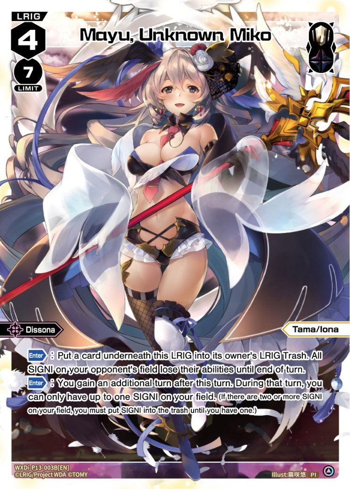

# Mayu, Unknown Miko

## Thông tin lá

| Trường | Giá trị |
| --- | --- |
| Mã in | WXDi-P13-003B[EN] |
| Set | WXDi-P13[EN] |
| Số thứ tự | 003B |
| Loại thẻ | LRIG |
| Vị trí | LRIG Deck |
| Số bản | — (set booster, không áp dụng) |
| Màu | Trắng / đen |
| Độ hiếm | PI,LRP,UR,SP |
| Minh họa | 繭咲悠 |
| Level | 4 |
| Limit | 7 |
| Power | 0 |
| LRIG type / Class | Tama/Iona |
| Team / Master | — |
| Cost | — |
| Grow cost | — |
| Use timing | — |
| Life Burst | Không |

## Card text chính thức

[Enter]: Put a card underneath this LRIG into its owner's LRIG Trash. All SIGNI on your opponent's field lose their abilities until end of turn.
[Enter]: You gain an additional turn after this turn. During that turn, you can only have up to one SIGNI on your field. (If there are two or more SIGNI on your field, you must put SIGNI into the trash until you have one.)

## Power text / Life Burst

—

## Ghi chú minh họa
Artist: 繭咲悠. Ảnh PI được tải từ Card List tiếng Anh.

## FAQ chính thức

**Q. Is this card treated as both PIECE and SIGNI when it is in the LRIG deck?**
A. No, this card is treated as an A-side PIECE when in the LRIG deck and not as SIGNI.

**Q. What exactly does the second [Enter] ability "you can only put up to one SIGNI onto your field." mean?**
A. During that turn, if you have more than one SIGNI, put it into the Trash so that there is only one SIGNI as Rule-based Action. It does not mean that you can only put SIGNI onto the field once. You can move one SIGNI from the field by some effect or process, and then put another SIGNI into the field.

**Q. Does my opponent put SIGNI onto the field during the same turn after the second [Enter] ability is resolved lose its ability?**
A. No, this effect only affects SIGNI on your opponent's field when it resolves, and later SIGNI do not lose their abilities.

## Ảnh biến thể

- [LRP](../images/WXDi-P13-003BP-EN.jpg)
- [SP](../images/WXDi-P13-003BSP-EN.jpg)
- [UR](../images/WXDi-P13-003BU-EN.jpg)

## Nguồn
[Card List/FAQ chính thức](https://www.takaratomy.co.jp/products/en.wixoss/card/card.html?card_no=WXDi-P13-003B%5BEN%5D ) · [Ảnh thẻ](https://www.takaratomy.co.jp/products/en.wixoss/card/thumb/WXDi-P13-003B%5BEN%5D.jpg)
