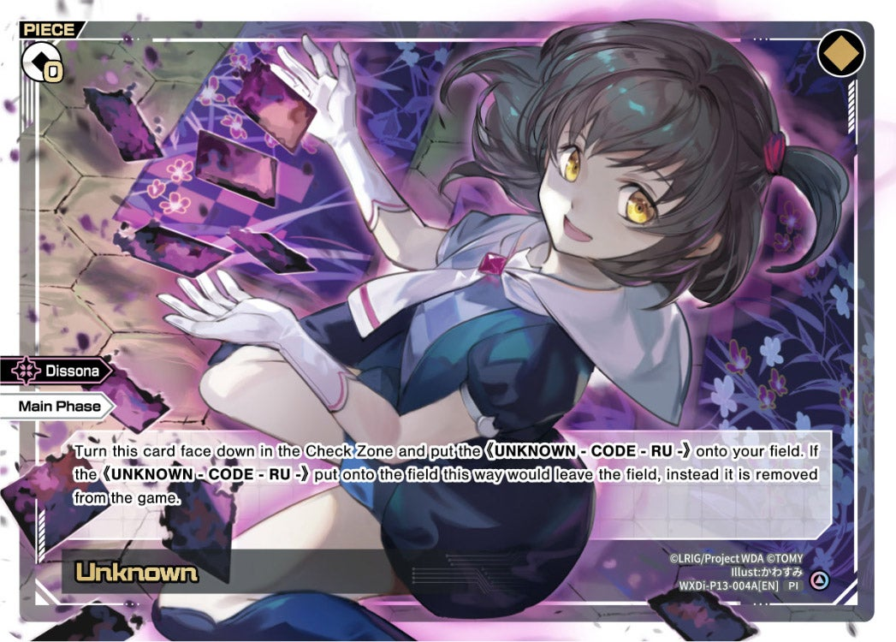

# Unknown

## Thông tin lá

| Trường | Giá trị |
| --- | --- |
| Mã in | WXDi-P13-004A[EN] |
| Set | WXDi-P13[EN] |
| Số thứ tự | 004A |
| Loại thẻ | PIECE |
| Vị trí | LRIG Deck |
| Số bản | — (set booster, không áp dụng) |
| Màu | Không màu |
| Độ hiếm | PI,LRP |
| Minh họa | かわすみ |
| Level | — |
| Limit | — |
| Power | 0 |
| LRIG type / Class | — |
| Team / Master | — |
| Cost | 《C》×０ |
| Grow cost | — |
| Use timing | Main Phase |
| Life Burst | Không |

## Card text chính thức

Turn this card face down in the Check Zone and put the 《UNKNOWN - CODE - RU -》 onto your field. If the 《UNKNOWN - CODE - RU -》 put onto the field this way would leave the field, instead it is removed from the game.

## Power text / Life Burst

—

## Ghi chú minh họa
Artist: かわすみ. Ảnh PI được tải từ Card List tiếng Anh.

## FAQ chính thức

**Q. Is this card treated as both PIECE and SIGNI when it is in the LRIG deck?**
A. No, this card is treated as an A-side PIECE when in the LRIG deck and not as SIGNI.

**Q. What happens if I use this PIECE when my center LRIG is at level two or less?**
A. In this case, the face down《UNKNOWN-CODE-RU-》 cannot be put onto the field. The card in the Check Zone is removed from the game as PIECE whose use has resolved, even if it is face downed, as per normal usage procedures. The same applies if the SIGNI Zone is all occupied and cannot be put.

## Ảnh biến thể

- [LRP](../images/WXDi-P13-004AP-EN.jpg)

## Nguồn
[Card List/FAQ chính thức](https://www.takaratomy.co.jp/products/en.wixoss/card/card.html?card_no=WXDi-P13-004A%5BEN%5D ) · [Ảnh thẻ](https://www.takaratomy.co.jp/products/en.wixoss/card/thumb/WXDi-P13-004A%5BEN%5D.jpg)
