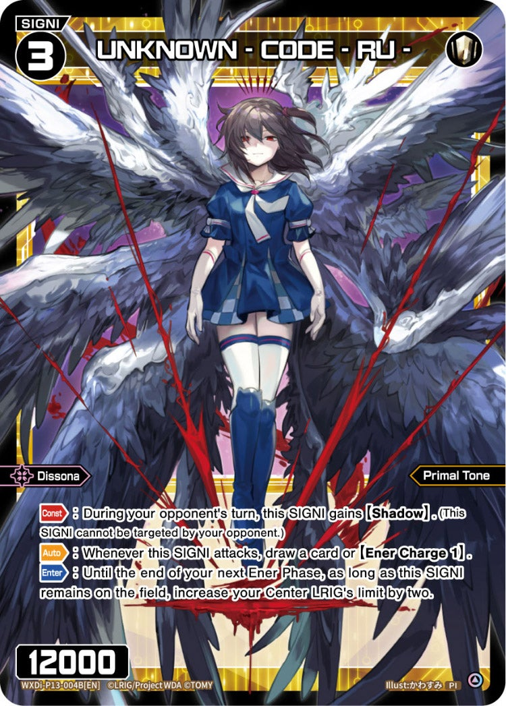

# UNKNOWN - CODE - RU -

## Thông tin lá

| Trường | Giá trị |
| --- | --- |
| Mã in | WXDi-P13-004B[EN] |
| Set | WXDi-P13[EN] |
| Số thứ tự | 004B |
| Loại thẻ | SIGNI |
| Vị trí | Main Deck |
| Số bản | — (set booster, không áp dụng) |
| Màu | Trắng |
| Độ hiếm | PI,LRP |
| Minh họa | かわすみ |
| Level | 3 |
| Limit | — |
| Power | 12000 |
| LRIG type / Class | Primal Tone |
| Team / Master | — |
| Cost | — |
| Grow cost | — |
| Use timing | — |
| Life Burst | Không |

## Card text chính thức

[Constant]: During your opponent's turn, this SIGNI gains 【Shadow】. (This SIGNI cannot be targeted by your opponent.)
[Auto]: Whenever this SIGNI attacks, draw a card or 【Ener Charge 1】.
[Enter]: Until the end of your next Ener Phase, as long as this SIGNI remains on the field, increase your Center LRIG's limit by two.

## Power text / Life Burst

—

## Ghi chú minh họa
Artist: かわすみ. Ảnh PI được tải từ Card List tiếng Anh.

## FAQ chính thức

**Q. Is this card treated as both PIECE and SIGNI when it is in the LRIG deck?**
A. No, this card is treated as an A-side PIECE when in the LRIG deck and not as SIGNI.

**Q. If this SIGNI loses its abilities after resolving the [Enter] ability, does the limit return?**
A. No, this effect is neither [Const] ability nor gained by this SIGNI itself, so the your Center LRIG's limit remains increase two even if the abilities are lost.

## Ảnh biến thể

- [LRP](../images/WXDi-P13-004BP-EN.jpg)

## Nguồn
[Card List/FAQ chính thức](https://www.takaratomy.co.jp/products/en.wixoss/card/card.html?card_no=WXDi-P13-004B%5BEN%5D ) · [Ảnh thẻ](https://www.takaratomy.co.jp/products/en.wixoss/card/thumb/WXDi-P13-004B%5BEN%5D.jpg)
