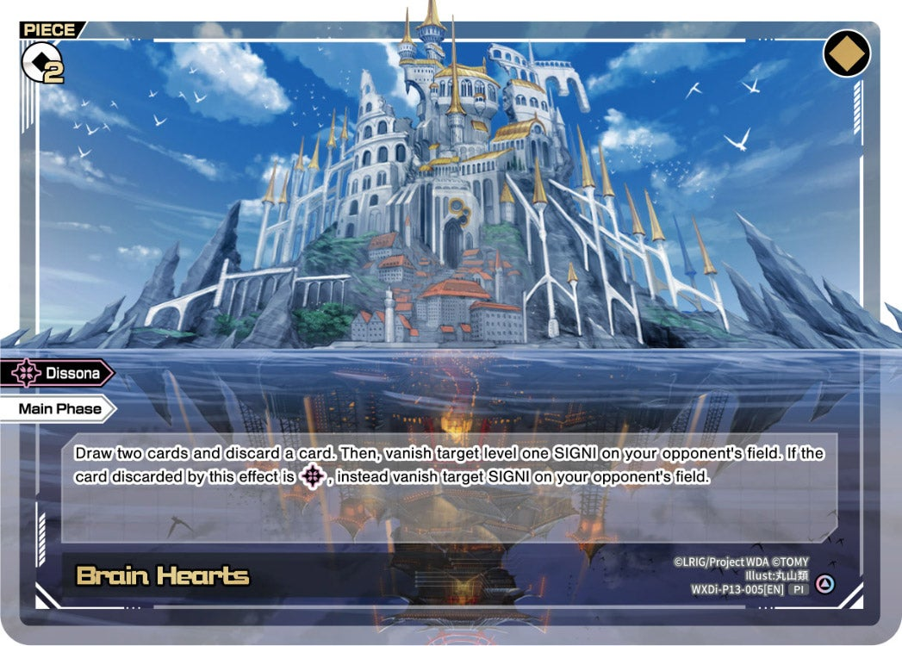

# Brain Hearts

## Thông tin lá

| Trường | Giá trị |
| --- | --- |
| Mã in | WXDi-P13-005[EN] |
| Set | WXDi-P13[EN] |
| Số thứ tự | 005 |
| Loại thẻ | PIECE |
| Vị trí | LRIG Deck |
| Số bản | — (set booster, không áp dụng) |
| Màu | Không màu |
| Độ hiếm | PI,LRP |
| Minh họa | 丸山類 |
| Level | — |
| Limit | — |
| Power | 0 |
| LRIG type / Class | — |
| Team / Master | — |
| Cost | 《C》×２ |
| Grow cost | — |
| Use timing | Main Phase |
| Life Burst | Không |

## Card text chính thức

Draw two cards and discard a card. Then, vanish target level one SIGNI on your opponent's field. If the card discarded by this effect is {Dissona Icon}, instead vanish target SIGNI on your opponent's field.

## Power text / Life Burst

—

## Ghi chú minh họa
Artist: 丸山類. Ảnh PI được tải từ Card List tiếng Anh.

## FAQ chính thức

**Q. I drew two cards in the first effect and now I have zero cards in my deck. What happens now?**
A. Even if your deck is reduced to zero cards during the processing of the effect, first process this effect to resolution. If afterwards there are still zero cards in your deck, it is refreshed by Rule-based Action.

## Ảnh biến thể

- [LRP](../images/WXDi-P13-005P-EN.jpg)

## Nguồn
[Card List/FAQ chính thức](https://www.takaratomy.co.jp/products/en.wixoss/card/card.html?card_no=WXDi-P13-005%5BEN%5D ) · [Ảnh thẻ](https://www.takaratomy.co.jp/products/en.wixoss/card/thumb/WXDi-P13-005%5BEN%5D.jpg)
