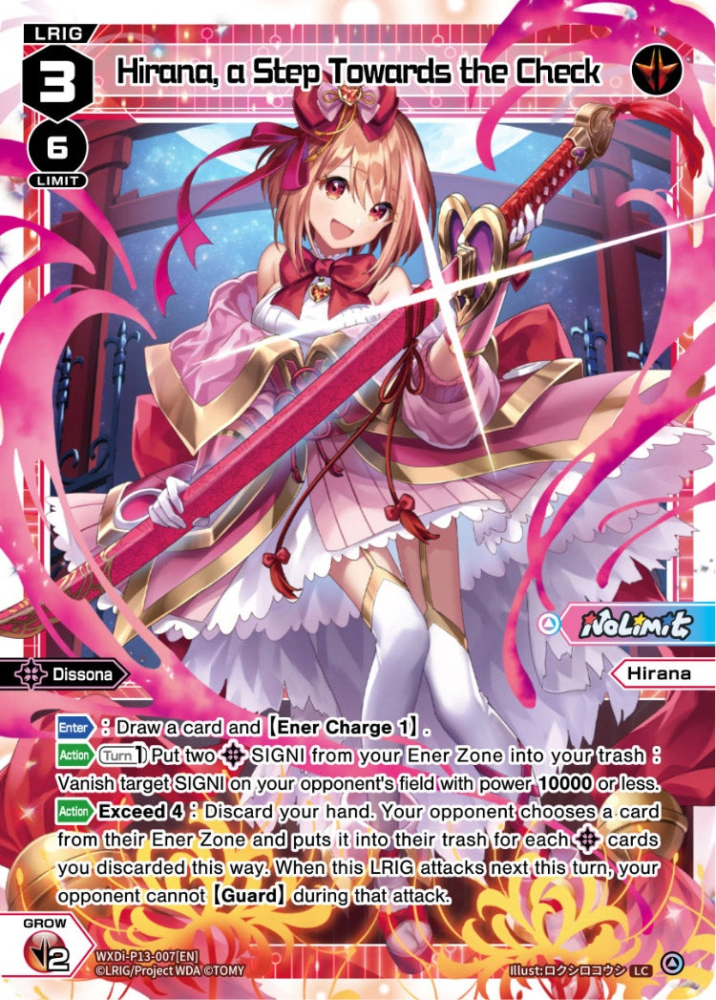

# Hirana, a Step Towards the Check

## Thông tin lá

| Trường | Giá trị |
| --- | --- |
| Mã in | WXDi-P13-007[EN] |
| Set | WXDi-P13[EN] |
| Số thứ tự | 007 |
| Loại thẻ | LRIG |
| Vị trí | LRIG Deck |
| Số bản | — (set booster, không áp dụng) |
| Màu | Đỏ |
| Độ hiếm | LC,LR,LRP,UR |
| Minh họa | ロクシロコウシ |
| Level | 3 |
| Limit | 6 |
| Power | 0 |
| LRIG type / Class | Hirana |
| Team / Master | No Limit |
| Cost | — |
| Grow cost | 《R》×２ |
| Use timing | — |
| Life Burst | Không |

## Card text chính thức

[Enter]: Draw a card and 【Ener Charge 1】.
[Action] {1/Turn} Put two {Dissona Icon} SIGNI from your Ener Zone into your trash: Vanish target SIGNI on your opponent's field with power 10000 or less.
[Action] Exceed 4: Discard your hand. Your opponent chooses a card from their Ener Zone and puts it into their trash for each {Dissona Icon} cards you discarded this way. When this LRIG attacks next this turn, your opponent cannot 【Guard】 during that attack.

## Power text / Life Burst

—

## Ghi chú minh họa
Artist: ロクシロコウシ. Ảnh LC được tải từ Card List tiếng Anh.

## FAQ chính thức

**Q. What happens if I already have zero cards in my hand when I use the second [Action] ability?**
A. In this case, you have not discarded any cards, so cards in your opponent's Ener Zone cannot be put into the Trash, but the latter half of the effect is dealt with and your opponent cannot [Guard] on the next attack of this LRIG.

## Ảnh biến thể

- [LRP](../images/WXDi-P13-007P-EN.jpg)
- [LR](../images/WXDi-P13-007R-EN.jpg)
- [UR](../images/WXDi-P13-007U-EN.jpg)

## Nguồn
[Card List/FAQ chính thức](https://www.takaratomy.co.jp/products/en.wixoss/card/card.html?card_no=WXDi-P13-007%5BEN%5D ) · [Ảnh thẻ](https://www.takaratomy.co.jp/products/en.wixoss/card/thumb/WXDi-P13-007%5BEN%5D.jpg)
