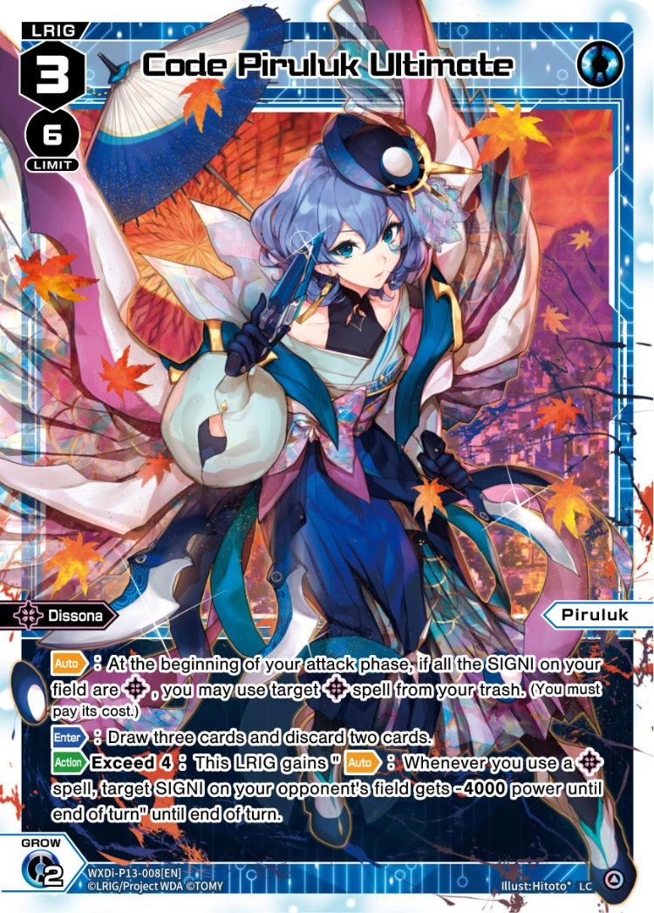

# Code Piruluk Ultimate

## Thông tin lá

| Trường | Giá trị |
| --- | --- |
| Mã in | WXDi-P13-008[EN] |
| Set | WXDi-P13[EN] |
| Số thứ tự | 008 |
| Loại thẻ | LRIG |
| Vị trí | LRIG Deck |
| Số bản | — (set booster, không áp dụng) |
| Màu | Xanh dương |
| Độ hiếm | LC,LR,LRP,UR |
| Minh họa | Hitoto* |
| Level | 3 |
| Limit | 6 |
| Power | 0 |
| LRIG type / Class | Piruluk |
| Team / Master | — |
| Cost | — |
| Grow cost | 《U》×２ |
| Use timing | — |
| Life Burst | Không |

## Card text chính thức

[Auto]: At the beginning of your attack phase, if all the SIGNI on your field are {Dissona Icon}, you may use target {Dissona Icon} spell from your trash. (You must pay its cost.)
[Enter]: Draw three cards and discard two cards.
[Action] Exceed 4: This LRIG gains "[Auto]: Whenever you use a {Dissona Icon} spell, target SIGNI on your opponent's field gets -4000 power until end of turn" until end of turn.

## Power text / Life Burst

—

## Ghi chú minh họa
Artist: Hitoto*. Ảnh LC được tải từ Card List tiếng Anh.

## FAQ chính thức

**Q. If the only one SIGNI with {Dissona Icon} on my field, does it meet the conditions for the [Auto] ability?**
A. Yes, even if there is only one, as long as it is SIGNI with {Dissona Icon}, the condition is met. It is not necessary to have SIGNI with {Dissona Icon} in all SIGNI Zones.

## Ảnh biến thể

- [LRP](../images/WXDi-P13-008P-EN.jpg)
- [LR](../images/WXDi-P13-008R-EN.jpg)
- [UR](../images/WXDi-P13-008U-EN.jpg)

## Nguồn
[Card List/FAQ chính thức](https://www.takaratomy.co.jp/products/en.wixoss/card/card.html?card_no=WXDi-P13-008%5BEN%5D ) · [Ảnh thẻ](https://www.takaratomy.co.jp/products/en.wixoss/card/thumb/WXDi-P13-008%5BEN%5D.jpg)
