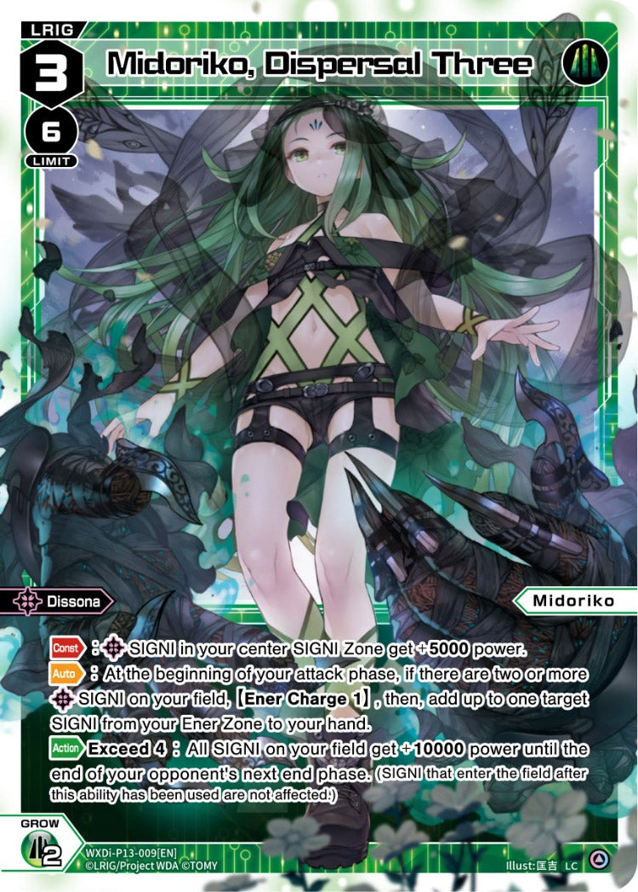

# Midoriko, Dispersal Three

## Thông tin lá

| Trường | Giá trị |
| --- | --- |
| Mã in | WXDi-P13-009[EN] |
| Set | WXDi-P13[EN] |
| Số thứ tự | 009 |
| Loại thẻ | LRIG |
| Vị trí | LRIG Deck |
| Số bản | — (set booster, không áp dụng) |
| Màu | Xanh lá |
| Độ hiếm | LC,LR,LRP,UR |
| Minh họa | 匡吉 |
| Level | 3 |
| Limit | 6 |
| Power | 0 |
| LRIG type / Class | Midoriko |
| Team / Master | — |
| Cost | — |
| Grow cost | 《G》×２ |
| Use timing | — |
| Life Burst | Không |

## Card text chính thức

[Constant]: {Dissona Icon} SIGNI in your center SIGNI Zone get +5000 power.
[Auto]: At the beginning of your attack phase, if there are two or more {Dissona Icon} SIGNI on your field, 【Ener Charge 1】, then, add up to one target SIGNI from your Ener Zone to your hand.
[Action] Exceed 4: All SIGNI on your field get +10000 power until the end of your opponent's next end phase. (SIGNI that enter the field after this ability has been used are not affected.)

## Power text / Life Burst

—

## Ghi chú minh họa
Artist: 匡吉. Ảnh LC được tải từ Card List tiếng Anh.

## FAQ chính thức

— (không có FAQ riêng cho mã này trên trang FAQ tiếng Anh.)

## Ảnh biến thể

- [LRP](../images/WXDi-P13-009P-EN.jpg)
- [LR](../images/WXDi-P13-009R-EN.jpg)
- [UR](../images/WXDi-P13-009U-EN.jpg)

## Nguồn
[Card List/FAQ chính thức](https://www.takaratomy.co.jp/products/en.wixoss/card/card.html?card_no=WXDi-P13-009%5BEN%5D ) · [Ảnh thẻ](https://www.takaratomy.co.jp/products/en.wixoss/card/thumb/WXDi-P13-009%5BEN%5D.jpg)
