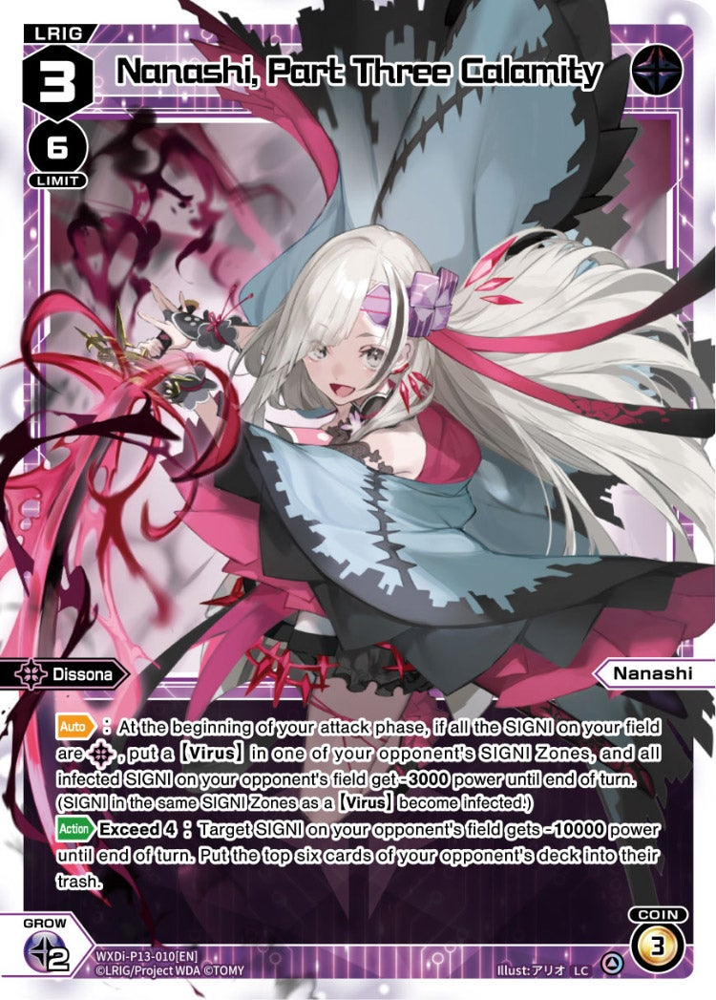

# Nanashi, Part Three Calamity

## Thông tin lá

| Trường | Giá trị |
| --- | --- |
| Mã in | WXDi-P13-010[EN] |
| Set | WXDi-P13[EN] |
| Số thứ tự | 010 |
| Loại thẻ | LRIG |
| Vị trí | LRIG Deck |
| Số bản | — (set booster, không áp dụng) |
| Màu | Đen |
| Độ hiếm | LC,LR,LRP,UR |
| Minh họa | アリオ |
| Level | 3 |
| Limit | 6 |
| Power | 0 |
| LRIG type / Class | Nanashi |
| Team / Master | — |
| Cost | — |
| Grow cost | 《B》×２ |
| Use timing | — |
| Life Burst | Không |

## Card text chính thức

[Auto]: At the beginning of your attack phase, if all the SIGNI on your field are {Dissona Icon}, put a 【Virus】 in one of your opponent's SIGNI Zones, and all infected SIGNI on your opponent's field get -3000 power until end of turn.
(SIGNI in the same SIGNI Zones as a 【Virus】 become infected.)
[Action] Exceed 4: Target SIGNI on your opponent's field gets -10000 power until end of turn. Put the top six cards of your opponent's deck into their trash.

## Power text / Life Burst

—

## Ghi chú minh họa
Artist: アリオ. Ảnh LC được tải từ Card List tiếng Anh.

## FAQ chính thức

**Q. If the only one SIGNI with {Dissona Icon} on my field, does it meet the conditions for the [Auto] ability?**
A. Yes, even if there is only one, as long as it is SIGNI with {Dissona Icon}, the condition is met. It is not necessary to have SIGNI with {Dissona Icon} in all SIGNI Zones.

**Q. Does SIGNI in the SIGNI Zone that has placed a [Virus] by the [Auto] ability immediately gets -3000 power as it is?**
A. Yes, the SIGNI in the SIGNI Zone where a [Virus] is placed immediately becomes Infected, and gets -3000 power by the effect that follows.

## Ảnh biến thể

- [LRP](../images/WXDi-P13-010P-EN.jpg)
- [LR](../images/WXDi-P13-010R-EN.jpg)
- [UR](../images/WXDi-P13-010U-EN.jpg)

## Nguồn
[Card List/FAQ chính thức](https://www.takaratomy.co.jp/products/en.wixoss/card/card.html?card_no=WXDi-P13-010%5BEN%5D ) · [Ảnh thẻ](https://www.takaratomy.co.jp/products/en.wixoss/card/thumb/WXDi-P13-010%5BEN%5D.jpg)
