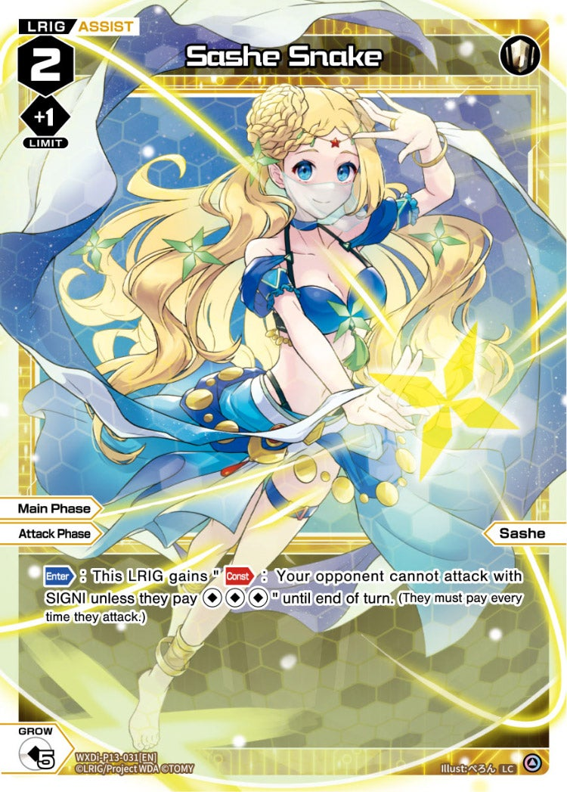

# Sashe Snake

## Thông tin lá

| Trường | Giá trị |
| --- | --- |
| Mã in | WXDi-P13-031[EN] |
| Set | WXDi-P13[EN] |
| Số thứ tự | 031 |
| Loại thẻ | ASSIST LRIG |
| Vị trí | LRIG Deck |
| Số bản | — (set booster, không áp dụng) |
| Màu | Trắng |
| Độ hiếm | LC,LC(P) |
| Minh họa | ぺろん |
| Level | 2 |
| Limit | ＋１ |
| Power | 0 |
| LRIG type / Class | Sashe |
| Team / Master | — |
| Cost | — |
| Grow cost | 《C》×５ |
| Use timing | Main Phase
Attack Phase |
| Life Burst | Không |

## Card text chính thức

[Enter]: This LRIG gains "[Constant]: Your opponent cannot attack with SIGNI unless they pay {Colorless} {Colorless} {Colorless}" until end of turn. (They must pay every time they attack.)

## Power text / Life Burst

—

## Ghi chú minh họa
Artist: ぺろん. Ảnh LC được tải từ Card List tiếng Anh.

## FAQ chính thức

**Q. When does my opponent pay {colorless} {colorless} {colorless}?**
A. On the SIGNI Attack Step, choose a SIGNI to attack and pay when it is downed. (If your opponent does not pay, it cannot attack and is not downed.)

**Q. When one SIGNI attacks, ups and attacks again, does it also pay {colorless} {colorless} {colorless} again?**
A. Yes, your opponent must pay {colorless} {colorless} {colorless} for each attack, whether it is two attacks by the same SIGNI or one attack by separate SIGNI.

## Ảnh biến thể

- [LC(P)](../images/WXDi-P13-031P-EN.jpg)

## Nguồn
[Card List/FAQ chính thức](https://www.takaratomy.co.jp/products/en.wixoss/card/card.html?card_no=WXDi-P13-031%5BEN%5D ) · [Ảnh thẻ](https://www.takaratomy.co.jp/products/en.wixoss/card/thumb/WXDi-P13-031%5BEN%5D.jpg)
