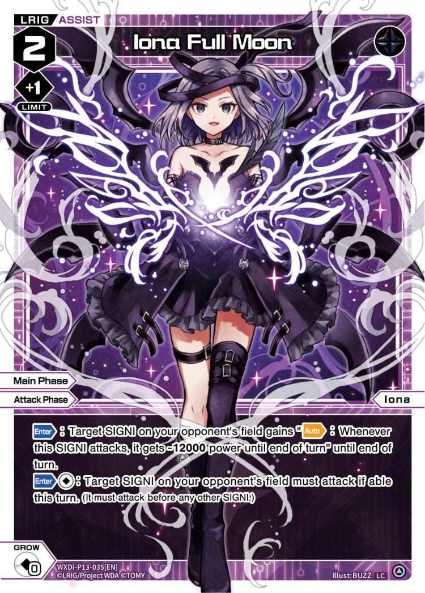

# Iona Full Moon

## Thông tin lá

| Trường | Giá trị |
| --- | --- |
| Mã in | WXDi-P13-035[EN] |
| Set | WXDi-P13[EN] |
| Số thứ tự | 035 |
| Loại thẻ | ASSIST LRIG |
| Vị trí | LRIG Deck |
| Số bản | — (set booster, không áp dụng) |
| Màu | Đen |
| Độ hiếm | LC,LC(P) |
| Minh họa | BUZZ |
| Level | 2 |
| Limit | ＋１ |
| Power | 0 |
| LRIG type / Class | Iona |
| Team / Master | — |
| Cost | — |
| Grow cost | 《C》×０ |
| Use timing | Main Phase / Attack Phase |
| Life Burst | Không |

## Card text chính thức

[Enter]: Target SIGNI on your opponent's field gains "[Auto]: Whenever this SIGNI attacks, it gets -12000 power until end of turn" until end of turn.
[Enter] {Colorless}: Target SIGNI on your opponent's field must attack if able this turn. (It must attack before any other SIGNI.)

## Power text / Life Burst

—

## Ghi chú minh họa
Artist: BUZZ. Ảnh LC được tải từ Card List tiếng Anh.

## FAQ chính thức

**Q. If SIGNI that has gained the [Auto] ability by the the first [Enter] ability attacks and gets -12000 power and its power is reduced to 0 or less, what happens to the attack?**
A. If power is reduced to 0, it is vanished by Rule-based Action. No battle with the front SIGNI or damage to the opponent occurs.

**Q. The SIGNI targeted by the second [Enter] ability this LRIG is given the [Auto] ability of 《Tamamozen, Phantom Spirit Queen》, "[Const]: This SIGNI cannot attack unless you pay {colorless}." Does the SIGNI must be attack with paying Ener?**
A. No, not necessarily. That SIGNI must attack if it can, but it is not forced to pay Ener, so if your opponent chooses not to pay, it is an unattackable SIGNI and consequently your opponent can choose not to attack. In this case, your opponent can also choose to pay Ener to attack that SIGNI after another SIGNI has attacked.

## Ảnh biến thể

- [LC(P)](../images/WXDi-P13-035P-EN.jpg)

## Nguồn
[Card List/FAQ chính thức](https://www.takaratomy.co.jp/products/en.wixoss/card/card.html?card_no=WXDi-P13-035%5BEN%5D ) · [Ảnh thẻ](https://www.takaratomy.co.jp/products/en.wixoss/card/thumb/WXDi-P13-035%5BEN%5D.jpg)
