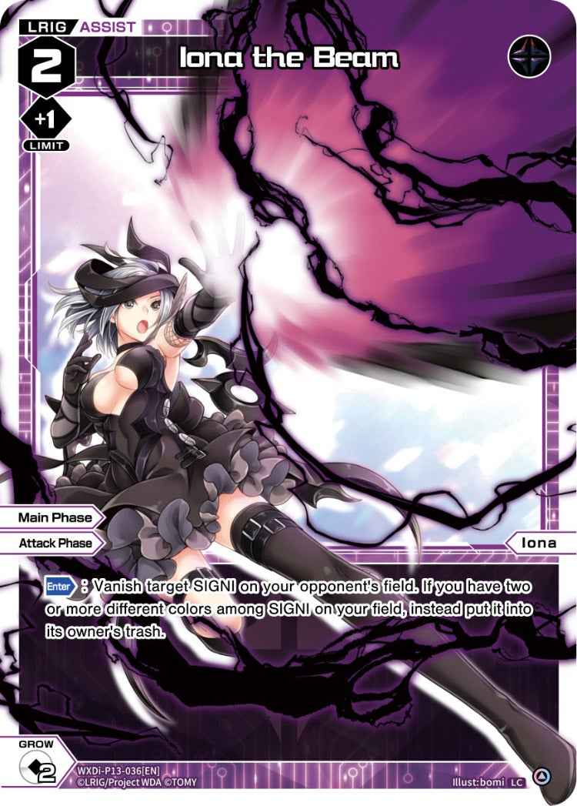

# Iona the Beam

## Thông tin lá

| Trường | Giá trị |
| --- | --- |
| Mã in | WXDi-P13-036[EN] |
| Set | WXDi-P13[EN] |
| Số thứ tự | 036 |
| Loại thẻ | ASSIST LRIG |
| Vị trí | LRIG Deck |
| Số bản | — (set booster, không áp dụng) |
| Màu | Đen |
| Độ hiếm | LC,LC(P) |
| Minh họa | bomi |
| Level | 2 |
| Limit | ＋１ |
| Power | 0 |
| LRIG type / Class | Iona |
| Team / Master | — |
| Cost | — |
| Grow cost | 《C》×２ |
| Use timing | Main Phase
Attack Phase |
| Life Burst | Không |

## Card text chính thức

[Enter]: Vanish target SIGNI on your opponent's field. If you have two or more different colors among SIGNI on your field, instead put it into its owner's trash.

## Power text / Life Burst

—

## Ghi chú minh họa
Artist: bomi. Ảnh LC được tải từ Card List tiếng Anh.

## FAQ chính thức

**Q. If SIGNI with two different colors, or two SIGNI each have a different color on my field, does this card's effect meet the conditions?**
A. Yes, both conditions are met if one SIGNI has two different colors or two SIGNI each have different color. However, colourless does not count as a type as it does not have a color.

## Ảnh biến thể

- [LC(P)](../images/WXDi-P13-036P-EN.jpg)

## Nguồn
[Card List/FAQ chính thức](https://www.takaratomy.co.jp/products/en.wixoss/card/card.html?card_no=WXDi-P13-036%5BEN%5D ) · [Ảnh thẻ](https://www.takaratomy.co.jp/products/en.wixoss/card/thumb/WXDi-P13-036%5BEN%5D.jpg)
