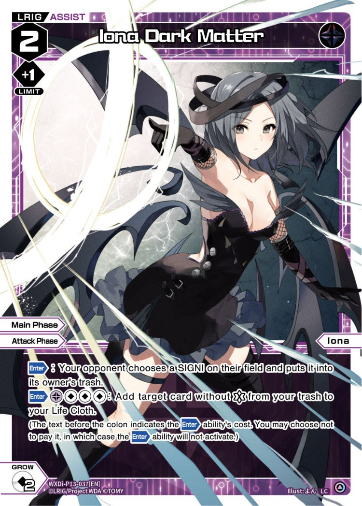

# Iona Dark Matter

## Thông tin lá

| Trường | Giá trị |
| --- | --- |
| Mã in | WXDi-P13-037[EN] |
| Set | WXDi-P13[EN] |
| Số thứ tự | 037 |
| Loại thẻ | ASSIST LRIG |
| Vị trí | LRIG Deck |
| Số bản | — (set booster, không áp dụng) |
| Màu | Đen |
| Độ hiếm | LC,LC(P) |
| Minh họa | よん |
| Level | 2 |
| Limit | ＋１ |
| Power | 0 |
| LRIG type / Class | Iona |
| Team / Master | — |
| Cost | — |
| Grow cost | 《C》×２ |
| Use timing | Main Phase
Attack Phase |
| Life Burst | Không |

## Card text chính thức

[Enter]: Your opponent chooses a SIGNI on their field and puts it into its owner's trash.
[Enter] {Black} {Colorless} {Colorless} {Colorless}: Add target card without 【Life Burst】 from your trash to your Life Cloth.
(The text before the colon indicates the [Enter] ability's cost. You may choose not to pay it, in which case the [Enter] ability will not activate.)

## Power text / Life Burst

—

## Ghi chú minh họa
Artist: よん. Ảnh LC được tải từ Card List tiếng Anh.

## FAQ chính thức

**Q. May my opponent choose their SIGNI with [Shadow] by the first [Enter] ability?**
A. Yes, your opponent can choose. [Shadow] is an ability that prevents a SIGNI from being the ‘target’ of an opponent's effects, but this card's effect has not chosen a ‘target’.

**Q. If I add a card from my trash to my Life Cloth by the second [Enter] ability, do I add it to the top of the Life Cloth?**
A. Yes, when moving a card to the Life Cloth, it is always put to the top of the Life Cloth.

## Ảnh biến thể

- [LC(P)](../images/WXDi-P13-037P-EN.jpg)

## Nguồn
[Card List/FAQ chính thức](https://www.takaratomy.co.jp/products/en.wixoss/card/card.html?card_no=WXDi-P13-037%5BEN%5D ) · [Ảnh thẻ](https://www.takaratomy.co.jp/products/en.wixoss/card/thumb/WXDi-P13-037%5BEN%5D.jpg)
