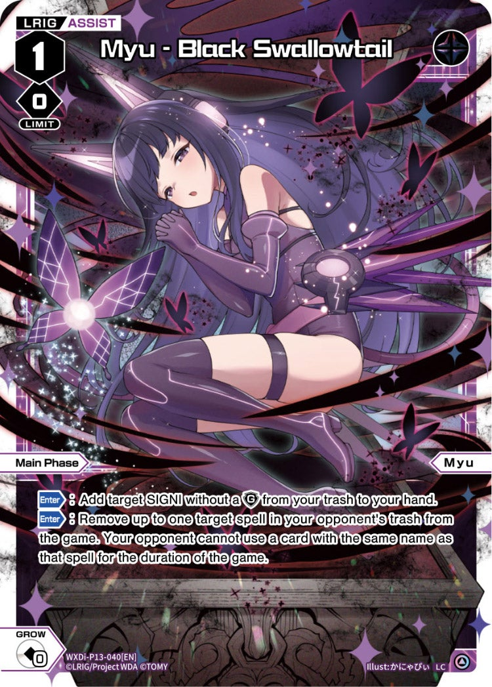

# Myu - Black Swallowtail

## Thông tin lá

| Trường | Giá trị |
| --- | --- |
| Mã in | WXDi-P13-040[EN] |
| Set | WXDi-P13[EN] |
| Số thứ tự | 040 |
| Loại thẻ | ASSIST LRIG |
| Vị trí | LRIG Deck |
| Số bản | — (set booster, không áp dụng) |
| Màu | Đen |
| Độ hiếm | LC,LC(P) |
| Minh họa | かにゃぴぃ |
| Level | 1 |
| Limit | 0 |
| Power | 0 |
| LRIG type / Class | Myu |
| Team / Master | — |
| Cost | — |
| Grow cost | 《C》×０ |
| Use timing | Main Phase |
| Life Burst | Không |

## Card text chính thức

[Enter]: Add target SIGNI without a {Guard Icon} from your trash to your hand.
[Enter]: Remove up to one target spell in your opponent's trash from the game. Your opponent cannot use a card with the same name as that spell for the duration of the game.

## Power text / Life Burst

—

## Ghi chú minh họa
Artist: かにゃぴぃ. Ảnh LC được tải từ Card List tiếng Anh.

## FAQ chính thức

**Q. If a spell is removed from the game by the second [Enter] ability, may the Life Burst with the same name as the spell not be triggered?**
A. No. it can be triggered. Life Burst is distinct from the use of spells and is not affected by that card's effect.

## Ảnh biến thể

- [LC(P)](../images/WXDi-P13-040P-EN.jpg)

## Nguồn
[Card List/FAQ chính thức](https://www.takaratomy.co.jp/products/en.wixoss/card/card.html?card_no=WXDi-P13-040%5BEN%5D ) · [Ảnh thẻ](https://www.takaratomy.co.jp/products/en.wixoss/card/thumb/WXDi-P13-040%5BEN%5D.jpg)
