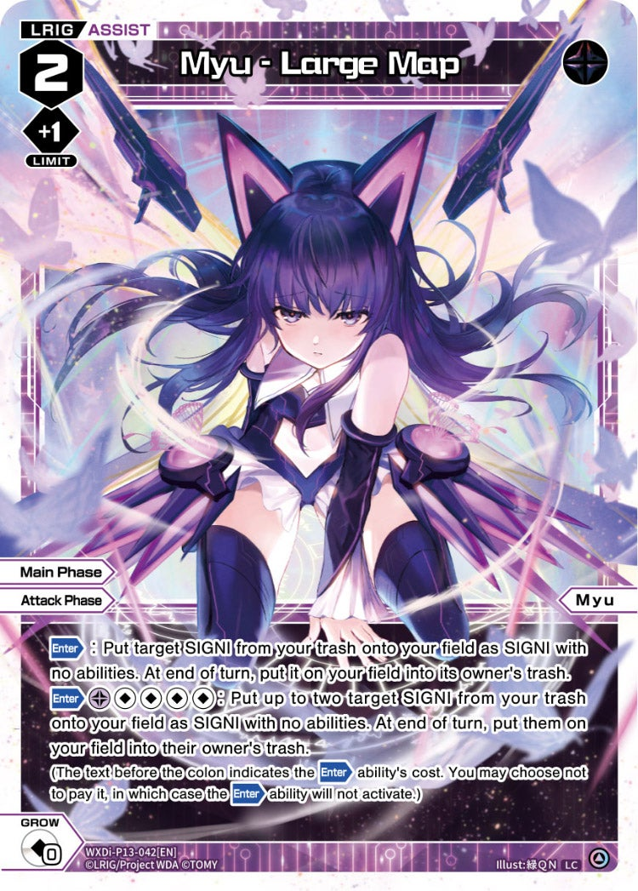

# Myu - Large Map

## Thông tin lá

| Trường | Giá trị |
| --- | --- |
| Mã in | WXDi-P13-042[EN] |
| Set | WXDi-P13[EN] |
| Số thứ tự | 042 |
| Loại thẻ | ASSIST LRIG |
| Vị trí | LRIG Deck |
| Số bản | — (set booster, không áp dụng) |
| Màu | Đen |
| Độ hiếm | LC,LC(P) |
| Minh họa | 緑QN |
| Level | 2 |
| Limit | ＋１ |
| Power | 0 |
| LRIG type / Class | Myu |
| Team / Master | — |
| Cost | — |
| Grow cost | 《C》×０ |
| Use timing | Main Phase
Attack Phase |
| Life Burst | Không |

## Card text chính thức

[Enter]: Put target SIGNI from your trash onto your field as SIGNI with no abilities. At end of turn, put it on your field into its owner's trash.
[Enter] {Black} {Colorless} {Colorless} {Colorless} {Colorless}: Put up to two target SIGNI from your trash onto your field as SIGNI with no abilities. At end of turn, put them on your field into their owner's trash.
(The text before the colon indicates the [Enter] ability's cost. You may choose not to pay it, in which case the [Enter] ability will not activate.)

## Power text / Life Burst

—

## Ghi chú minh họa
Artist: 緑QN. Ảnh LC được tải từ Card List tiếng Anh.

## FAQ chính thức

**Q. If a SIGNI put onto the field by this effect is placed underneath a SIGNI by [Rise] or other means, does it put into the Trash from underneath the SIGNI at the end of this turn?**
A. No. A card placed underneath a SIGNI is not put into the trash at the end of that turn. It will remain placed underneath the [Rise] SIGNI.

**Q. What happens if I put a SIGNI with [Harmony], such as 《Phalaris, Code: Ancients》, as a SIGNI without abilities?**
A. [Harmony] is an ability that triggers when it puts onto the field, so it does not trigger if it puts onto the field as a SIGNI without abilities. The LRIG cannot be downed, but will put onto the field in an upped.

**Q. What happens if I put a SIGNI with [Rise], such as 《Anna Mirage, Doomed Evil》, as a SIGNI without abilities?**
A. Just before you put it onto the field, it checks the conditions for putting it as a SIGNI with abilities, so you need to put it onto the top of a SIGNI to meet the Rise condition.

## Ảnh biến thể

- [LC(P)](../images/WXDi-P13-042P-EN.jpg)

## Nguồn
[Card List/FAQ chính thức](https://www.takaratomy.co.jp/products/en.wixoss/card/card.html?card_no=WXDi-P13-042%5BEN%5D ) · [Ảnh thẻ](https://www.takaratomy.co.jp/products/en.wixoss/card/thumb/WXDi-P13-042%5BEN%5D.jpg)
