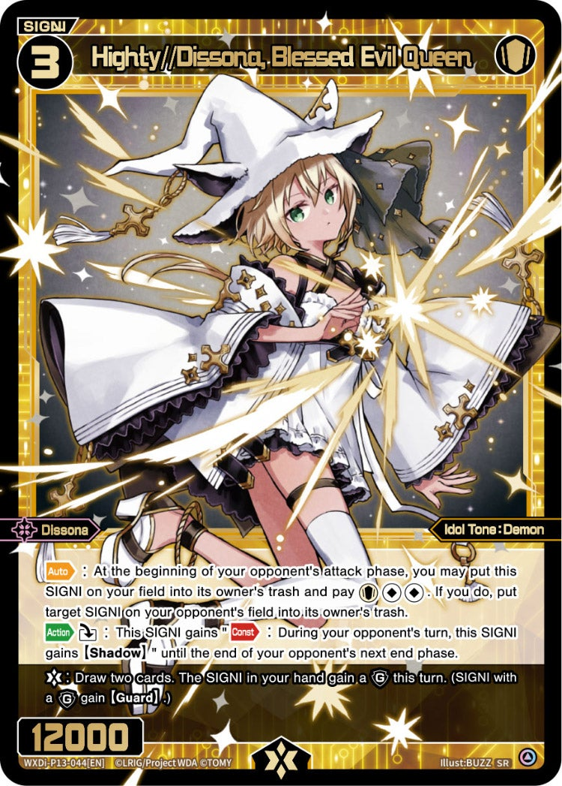

# Highty//Dissona, Blessed Evil Queen

## Thông tin lá

| Trường | Giá trị |
| --- | --- |
| Mã in | WXDi-P13-044[EN] |
| Set | WXDi-P13[EN] |
| Số thứ tự | 044 |
| Loại thẻ | SIGNI |
| Vị trí | Main Deck |
| Số bản | — (set booster, không áp dụng) |
| Màu | Trắng |
| Độ hiếm | SR,SRP |
| Minh họa | BUZZ |
| Level | 3 |
| Limit | — |
| Power | 12000 |
| LRIG type / Class | Idol Tone：Demon |
| Team / Master | — |
| Cost | — |
| Grow cost | — |
| Use timing | — |
| Life Burst | Có |

## Card text chính thức

[Auto]: At the beginning of your opponent's attack phase, you may put this SIGNI on your field into its owner's trash and pay {White} {Colorless} {Colorless}. If you do, put target SIGNI on your opponent's field into its owner's trash.
[Action] {Down}: This SIGNI gains "[Constant]: During your opponent's turn, this SIGNI gains 【Shadow】" until the end of your opponent's next end phase.

## Power text / Life Burst

Draw two cards. The SIGNI in your hand gain a {Guard Icon} this turn. (SIGNI with a {Guard Icon} gain 【Guard】.)

## Ghi chú minh họa
Artist: BUZZ. Ảnh SR được tải từ Card List tiếng Anh.

## FAQ chính thức

**Q. Does the SIGNI that resolves this card's Life Burst then added to my hand, for example by drawing a card, gain a {Guard Icon}?**
A. Yes, the SIGNI in your hand, including the SIGNI you draw later, have gained the {Guard Icon} this turn.

## Ảnh biến thể

- [SRP](../images/WXDi-P13-044P-EN.jpg)

## Nguồn
[Card List/FAQ chính thức](https://www.takaratomy.co.jp/products/en.wixoss/card/card.html?card_no=WXDi-P13-044%5BEN%5D ) · [Ảnh thẻ](https://www.takaratomy.co.jp/products/en.wixoss/card/thumb/WXDi-P13-044%5BEN%5D.jpg)
