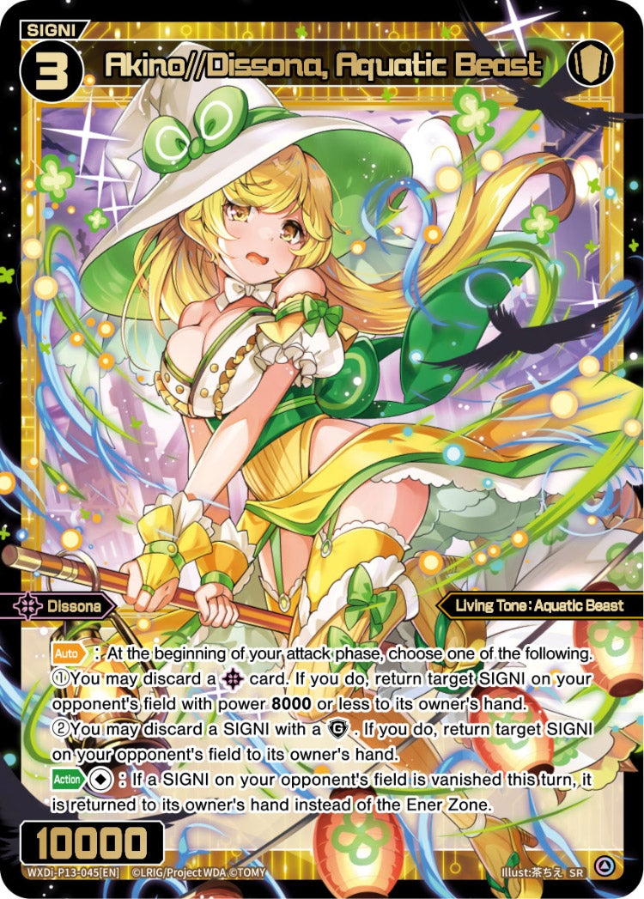

# Akino//Dissona, Aquatic Phantom Queen

## Thông tin lá

| Trường | Giá trị |
| --- | --- |
| Mã in | WXDi-P13-045[EN] |
| Set | WXDi-P13[EN] |
| Số thứ tự | 045 |
| Loại thẻ | SIGNI |
| Vị trí | Main Deck |
| Số bản | — (set booster, không áp dụng) |
| Màu | Trắng |
| Độ hiếm | SR,SRP |
| Minh họa | 茶ちえ |
| Level | 3 |
| Limit | — |
| Power | 10000 |
| LRIG type / Class | Living Tone：Aquatic Beast |
| Team / Master | — |
| Cost | — |
| Grow cost | — |
| Use timing | — |
| Life Burst | Không |

## Card text chính thức

[Auto]: At the beginning of your attack phase, choose one of the following.
①You may discard a {Dissona Icon} card. If you do, return target SIGNI on your opponent's field with power 8000 or less to its owner's hand.
②You may discard a SIGNI with a {Guard Icon}. If you do, return target SIGNI on your opponent's field to its owner's hand.
[Action] {Colorless}: If a SIGNI on your opponent's field is vanished this turn, it is returned to its owner's hand instead of putting into the Ener Zone.

## Power text / Life Burst

—

## Ghi chú minh họa
Artist: 茶ちえ. Ảnh SR được tải từ Card List tiếng Anh.

## FAQ chính thức

**Q. After using the [Action] ability, my opponent's SIGNI was vanished and returned to my opponent's hand instead of being put into the Ener Zone. If that SIGNI has an [Auto] ability that triggers "when this SIGNI is vanished", does it trigger?**
A. Yes, it is triggered. This effect only replaces the zone where it is placed if it is vanished, but the vanishing itself is valid.

## Ảnh biến thể

- [SRP](../images/WXDi-P13-045P-EN.jpg)

## Nguồn
[Card List/FAQ chính thức](https://www.takaratomy.co.jp/products/en.wixoss/card/card.html?card_no=WXDi-P13-045%5BEN%5D ) · [Ảnh thẻ](https://www.takaratomy.co.jp/products/en.wixoss/card/thumb/WXDi-P13-045%5BEN%5D.jpg)
