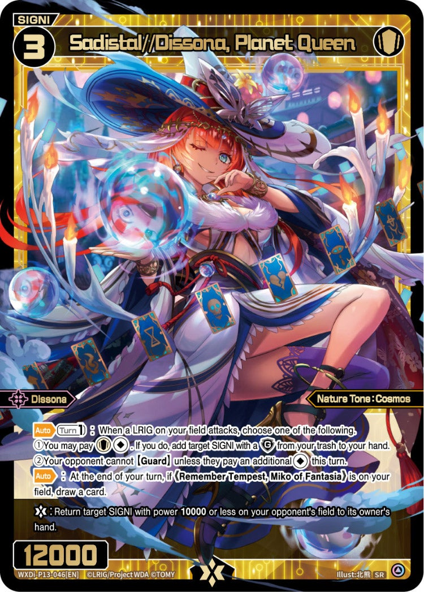

# Sadistal//Dissona, Planet Queen

## Thông tin lá

| Trường | Giá trị |
| --- | --- |
| Mã in | WXDi-P13-046[EN] |
| Set | WXDi-P13[EN] |
| Số thứ tự | 046 |
| Loại thẻ | SIGNI |
| Vị trí | Main Deck |
| Số bản | — (set booster, không áp dụng) |
| Màu | Trắng |
| Độ hiếm | SR,SRP |
| Minh họa | 北熊 |
| Level | 3 |
| Limit | — |
| Power | 12000 |
| LRIG type / Class | Nature Tone：Cosmos |
| Team / Master | — |
| Cost | — |
| Grow cost | — |
| Use timing | — |
| Life Burst | Có |

## Card text chính thức

[Auto] {1/Turn}: When a LRIG on your field attacks, choose one of the following.
①You may pay {White} {Colorless}. If you do, add target SIGNI with a {Guard Icon} from your trash to your hand.
②Your opponent cannot 【Guard】 unless they pay an additional {Colorless} this turn.
[Auto]: At the end of your turn, if 《Remember Tempest, Miko of Fantasia》 is on your field, draw a card.

## Power text / Life Burst

Return target SIGNI with power 10000 or less on your opponent's field to its owner's hand.

## Ghi chú minh họa
Artist: 北熊. Ảnh SR được tải từ Card List tiếng Anh.

## FAQ chính thức

**Q. After resolving (2) of the first [Auto] ability, my LRIG upped and attacked again. If my opponent want to use [Guard], does my opponent have to pay an additional {colorless}?**
A. Yes, this effect affects all [Guard] this turn, so your opponent cannot [Guard] without paying an additional {colorless} on the second LRIG attack.

## Ảnh biến thể

- [SRP](../images/WXDi-P13-046P-EN.jpg)

## Nguồn
[Card List/FAQ chính thức](https://www.takaratomy.co.jp/products/en.wixoss/card/card.html?card_no=WXDi-P13-046%5BEN%5D ) · [Ảnh thẻ](https://www.takaratomy.co.jp/products/en.wixoss/card/thumb/WXDi-P13-046%5BEN%5D.jpg)
