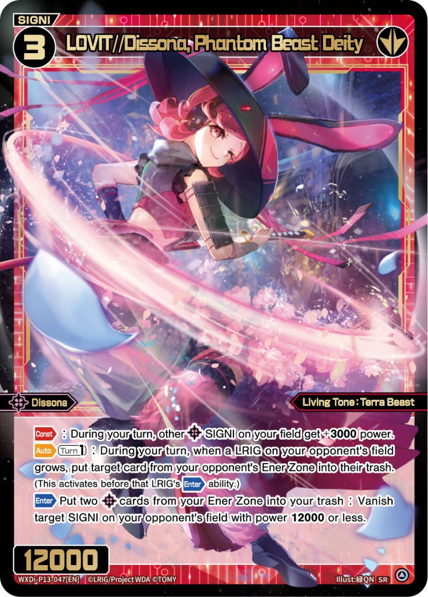

# LOVIT//Dissona, Phantom Beast Deity

## Thông tin lá

| Trường | Giá trị |
| --- | --- |
| Mã in | WXDi-P13-047[EN] |
| Set | WXDi-P13[EN] |
| Số thứ tự | 047 |
| Loại thẻ | SIGNI |
| Vị trí | Main Deck |
| Số bản | — (set booster, không áp dụng) |
| Màu | Đỏ |
| Độ hiếm | SR,SRP |
| Minh họa | 緑QN |
| Level | 3 |
| Limit | — |
| Power | 12000 |
| LRIG type / Class | Living Tone：Terra Beast |
| Team / Master | — |
| Cost | — |
| Grow cost | — |
| Use timing | — |
| Life Burst | Không |

## Card text chính thức

[Constant]: During your turn, other {Dissona Icon} SIGNI on your field get +3000 power.
[Auto] {1/Turn}: During your turn, when a LRIG on your opponent's field grows, put target card from your opponent's Ener Zone into their trash. (This activates before that LRIG's [Enter] ability.)
[Enter] Put two {Dissona Icon} cards from your Ener Zone into your trash: Vanish target SIGNI on your opponent's field with power 12000 or less.

## Power text / Life Burst

—

## Ghi chú minh họa
Artist: 緑QN. Ảnh SR được tải từ Card List tiếng Anh.

## FAQ chính thức

**Q. Which triggers first, the [Auto] ability or my opponent LRIG's [Enter] ability with a cost, if the [Enter] ability has a cost?**
A. This SIGNI's [Auto] ability triggers first. If a card in the Ener Zone put into the Trash by this SIGNI's [Auto] ability and the cost of the [Enter] ability cannot be paid, the [Enter] ability not be triggered.

**Q. Does the [Auto] ability trigger whether my opponent's Center LRIG grows or Assist LRIG grows?**
A. Yes, both are triggered because they are growing LRIG.

## Ảnh biến thể

- [SRP](../images/WXDi-P13-047P-EN.jpg)

## Nguồn
[Card List/FAQ chính thức](https://www.takaratomy.co.jp/products/en.wixoss/card/card.html?card_no=WXDi-P13-047%5BEN%5D ) · [Ảnh thẻ](https://www.takaratomy.co.jp/products/en.wixoss/card/thumb/WXDi-P13-047%5BEN%5D.jpg)
