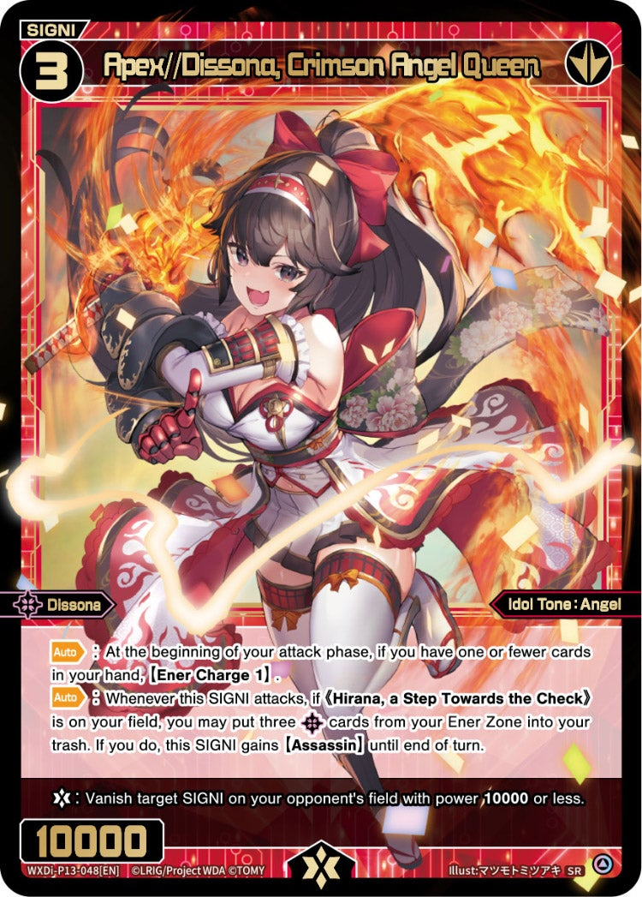

# Apex//Dissona, Crimson Angel Queen

## Thông tin lá

| Trường | Giá trị |
| --- | --- |
| Mã in | WXDi-P13-048[EN] |
| Set | WXDi-P13[EN] |
| Số thứ tự | 048 |
| Loại thẻ | SIGNI |
| Vị trí | Main Deck |
| Số bản | — (set booster, không áp dụng) |
| Màu | Đỏ |
| Độ hiếm | SR,SRP |
| Minh họa | マツモトミツアキ |
| Level | 3 |
| Limit | — |
| Power | 10000 |
| LRIG type / Class | Idol Tone：Angel |
| Team / Master | — |
| Cost | — |
| Grow cost | — |
| Use timing | — |
| Life Burst | Có |

## Card text chính thức

[Auto]: At the beginning of your attack phase, if you have one or fewer cards in your hand, 【Ener Charge 1】.
[Auto]: Whenever this SIGNI attacks, if 《Hirana, a Step Towards the Check》 is on your field, you may put three {Dissona Icon} cards from your Ener Zone into your trash. If you do, this SIGNI gains 【Assassin】 until end of turn.

## Power text / Life Burst

Vanish target SIGNI on your opponent's field with power 10000 or less.

## Ghi chú minh họa
Artist: マツモトミツアキ. Ảnh SR được tải từ Card List tiếng Anh.

## FAQ chính thức

— (không có FAQ riêng cho mã này trên trang FAQ tiếng Anh.)

## Ảnh biến thể

- [SRP](../images/WXDi-P13-048P-EN.jpg)

## Nguồn
[Card List/FAQ chính thức](https://www.takaratomy.co.jp/products/en.wixoss/card/card.html?card_no=WXDi-P13-048%5BEN%5D ) · [Ảnh thẻ](https://www.takaratomy.co.jp/products/en.wixoss/card/thumb/WXDi-P13-048%5BEN%5D.jpg)
