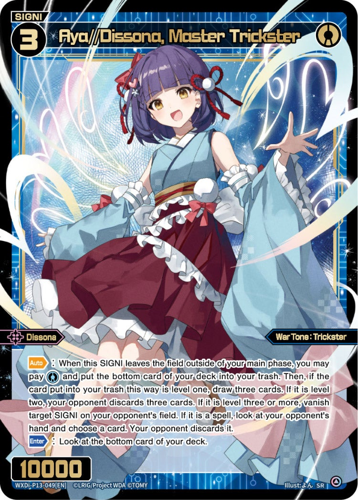

# Aya//Dissona, Master Trickster

## Thông tin lá

| Trường | Giá trị |
| --- | --- |
| Mã in | WXDi-P13-049[EN] |
| Set | WXDi-P13[EN] |
| Số thứ tự | 049 |
| Loại thẻ | SIGNI |
| Vị trí | Main Deck |
| Số bản | — (set booster, không áp dụng) |
| Màu | Xanh dương |
| Độ hiếm | SR,SRP |
| Minh họa | よん |
| Level | 3 |
| Limit | — |
| Power | 10000 |
| LRIG type / Class | War Tone：Trickster |
| Team / Master | — |
| Cost | — |
| Grow cost | — |
| Use timing | — |
| Life Burst | Không |

## Card text chính thức

[Auto]: When this SIGNI leaves the field outside of your main phase, you may pay {Blue} and put the bottom card of your deck into your trash. Then, if the card put into your trash this way is level one, draw three cards. If it is level two, your opponent discards three cards. If it is level three or more, vanish target SIGNI on your opponent's field. If it is a spell, look at your opponent's hand and choose a card. Your opponent discards it.
[Enter]: Look at the bottom card of your deck.

## Power text / Life Burst

—

## Ghi chú minh họa
Artist: よん. Ảnh SR được tải từ Card List tiếng Anh.

## FAQ chính thức

**Q. Does this [Auto] ability also trigger when put this SIGNI from the field into the Ener Zone in the Ener Phase?**
A. Yes, it triggers. You can also pay the {blue} of this effect with this SIGNI placed in the Ener Zone itself.

**Q. If I put 《Moon Bites》 into my trash by the [Auto] ability, may 《Moon Bites》 be treated as a level one SIGNI?**
A. Yes, it is possible. However, you cannot treat it as both a "spell" and a "level one SIGNI" in one effect, so when you treat it as a "level one SIGNI", you cannot discard a card from your opponent's hand.

## Ảnh biến thể

- [SRP](../images/WXDi-P13-049P-EN.jpg)

## Nguồn
[Card List/FAQ chính thức](https://www.takaratomy.co.jp/products/en.wixoss/card/card.html?card_no=WXDi-P13-049%5BEN%5D ) · [Ảnh thẻ](https://www.takaratomy.co.jp/products/en.wixoss/card/thumb/WXDi-P13-049%5BEN%5D.jpg)
