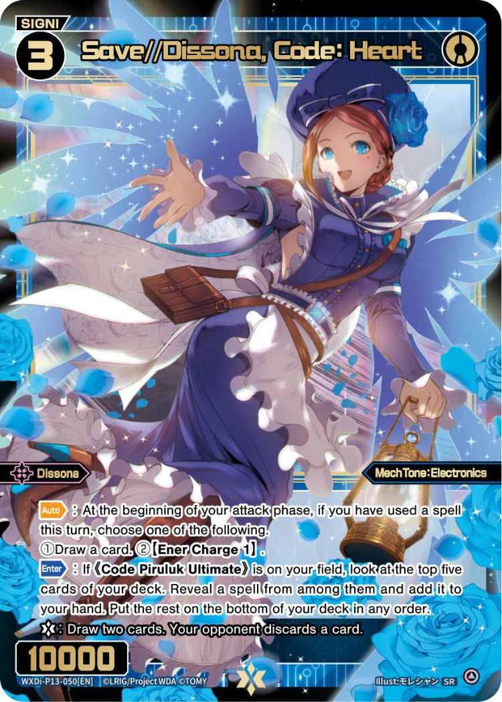

# Save//Dissona, Code: Heart

## Thông tin lá

| Trường | Giá trị |
| --- | --- |
| Mã in | WXDi-P13-050[EN] |
| Set | WXDi-P13[EN] |
| Số thứ tự | 050 |
| Loại thẻ | SIGNI |
| Vị trí | Main Deck |
| Số bản | — (set booster, không áp dụng) |
| Màu | Xanh dương |
| Độ hiếm | SR,SRP |
| Minh họa | モレシャン |
| Level | 3 |
| Limit | — |
| Power | 10000 |
| LRIG type / Class | Mech Tone：Electronics |
| Team / Master | — |
| Cost | — |
| Grow cost | — |
| Use timing | — |
| Life Burst | Có |

## Card text chính thức

[Auto]: At the beginning of your attack phase, if you have used a spell this turn, choose one of the following.
①Draw a card. ②【Ener Charge 1】.
[Enter]: If 《Code Piruluk Ultimate》 is on your field, look at the top five cards of your deck. Reveal a spell from among them and add it to your hand. Put the rest on the bottom of your deck in any order.

## Power text / Life Burst

Draw two cards. Your opponent discards a card.

## Ghi chú minh họa
Artist: モレシャン. Ảnh SR được tải từ Card List tiếng Anh.

## FAQ chính thức

**Q. I used a Spell on my turn and then put this SIGNI onto the field. Does the [Auto] ability trigger?**
A. Yes, it triggers. Check whether or not you have used a spell this turn, regardless of whether or not this SIGNI is on the field when the spell is used.

## Ảnh biến thể

- [SRP](../images/WXDi-P13-050P-EN.jpg)

## Nguồn
[Card List/FAQ chính thức](https://www.takaratomy.co.jp/products/en.wixoss/card/card.html?card_no=WXDi-P13-050%5BEN%5D ) · [Ảnh thẻ](https://www.takaratomy.co.jp/products/en.wixoss/card/thumb/WXDi-P13-050%5BEN%5D.jpg)
